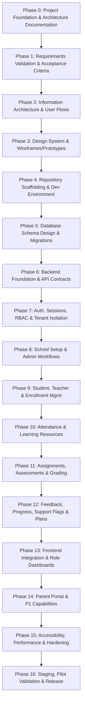

# Implementation Phase Roadmap

This document outlines the sequential, phase-gated delivery roadmap for the **FSD-SDG-4 Quality Education SaaS** platform. Development strictly advances phase-by-phase. Progress to a subsequent phase requires formal sign-off against documented exit criteria.

---

## Roadmap Overview

---

## Detailed Phase Breakdown

### PHASE 0 — Project Foundation and Architecture Documentation

- **Objective**: Establish the complete architectural, product, and operational blueprint before implementation begins.
- **Key Deliverables**: Complete `docs/` hierarchy, Architecture Decision Records (ADRs), C4 diagrams, ER conceptual model, REST API standards, and testing strategies.
- **Exit Criteria**: All architectural files reviewed, zero application code written, formal stakeholder sign-off.
- **Current Status**: **COMPLETED (Active Gate)**

### PHASE 1 — Requirements Validation and Product Acceptance Criteria

- **Dependencies**: Phase 0 sign-off.
- **Objective**: Review product assumptions with educational domain stakeholders and refine detailed Gherkin acceptance criteria for every user story.
- **Key Deliverables**: Validated functional requirements catalog, Gherkin acceptance test scenarios, resolved open questions (`OQ-001` to `OQ-004`).
- **Exit Criteria**: Product Lead (Vishwanath) and stakeholders ratify functional specification.

### PHASE 2 — Information Architecture, User Flows, and Screen Inventory

- **Dependencies**: Phase 1.
- **Objective**: Complete end-to-end navigational models, role-based user journey flows, and exhaustive screen inventories.
- **Key Deliverables**: Complete sitemaps per persona, detailed interaction diagrams for attendance and support workflows, full screen/modal inventory.
- **Exit Criteria**: UX workflows reviewed for teacher efficiency ($\le 90$s attendance) and mobile ergonomics.

### PHASE 3 — UI/UX Design System, Wireframes, and Clickable Prototype

- **Dependencies**: Phase 2.
- **Objective**: Establish the accessible design system (color tokens, typography, headless components) and build non-production wireframes.
- **Key Deliverables**: Figma design tokens or low-fidelity wireframes, WCAG 2.2 AA contrast matrix, interactive clickable prototype.
- **Exit Criteria**: Accessibility review completed; zero color contrast or keyboard navigation design flaws.

### PHASE 4 — Repository Scaffolding and Development Environment

- **Dependencies**: Phase 3.
- **Objective**: Initialize the monorepo or project structure, tooling, TypeScript configuration, linters, and testing harnesses.
- **Key Deliverables**: Initialized `package.json`, `tsconfig.json`, Vite, Tailwind, ESLint, Prettier, Vitest, Playwright setup, Docker Compose for local PostgreSQL.
- **Exit Criteria**: Clean build, lint, and test runs passing in automated local environment.

### PHASE 5 — Database Schema Design, ER Diagram Approval, and Migrations

- **Dependencies**: Phase 4.
- **Objective**: Finalize the physical PostgreSQL schema in Prisma ORM, establish relational constraints, indexes, and seed synthetic data.
- **Key Deliverables**: Approved `schema.prisma`, initial migration scripts, database indexing strategy, synthetic zero-PII seed script.
- **Exit Criteria**: Migration executes idempotently; foreign keys and multi-tenant constraints verified by Yashwardhan.

### PHASE 6 — Backend Foundation, API Contracts, and Security Controls

- **Dependencies**: Phase 5.
- **Objective**: Implement core Express modular monolith framework, Pino logger, RFC 7807 error middleware, and Zod validation.
- **Key Deliverables**: Express application skeleton, global error handler, correlation ID middleware, Zod request validators, OpenAPI contract generation.
- **Exit Criteria**: HTTP integration tests with Supertest verifying error handling and validation logic.

### PHASE 7 — Authentication, Sessions, RBAC, and Tenant Isolation

- **Dependencies**: Phase 6.
- **Objective**: Implement server-managed session authentication, Argon2id hashing, secure cookies, and tenant isolation guards.
- **Key Deliverables**: Session store, login/logout routes, password reset, RBAC middleware, Prisma tenant isolation extension.
- **Exit Criteria**: Automated tenant isolation test harness passing with 100% cross-tenant access rejection.

### PHASE 8 — School Setup and Administrative Workflows

- **Dependencies**: Phase 7.
- **Objective**: Build backend endpoints and school management logic for academic years, classes, sections, and subjects.
- **Key Deliverables**: School profile management, academic year transition workflows, class/section/subject endpoints with full audit logging.
- **Exit Criteria**: Administrative CRUD APIs fully tested with integration suites.

### PHASE 9 — Student, Teacher, and Enrollment Management

- **Dependencies**: Phase 8.
- **Objective**: Implement staff onboarding, student profiling, and academic enrollment linking students to sections and courses.
- **Key Deliverables**: Student and teacher service modules, enrollment management APIs, batch enrollment validation.
- **Exit Criteria**: Roster assignment logic verified; enrollments strictly bound to tenant and academic year.

### PHASE 10 — Attendance and Learning Resources

- **Dependencies**: Phase 9.
- **Objective**: Build daily attendance recording engine and learning resource repository.
- **Key Deliverables**: Attendance recording APIs (Present, Absent, Late, Excused), bulk attendance endpoints, resource upload and curation modules.
- **Exit Criteria**: Morning attendance bulk submission tests achieve $\le 200$ms response times under test load.

### PHASE 11 — Assignments, Submissions, Assessments, and Results

- **Dependencies**: Phase 10.
- **Objective**: Implement assignment publishing, student submission pipelines, assessment result recording, and weighted grading.
- **Key Deliverables**: Assignment lifecycle APIs, submission handling, assessment grading engine, gradebook aggregation services.
- **Exit Criteria**: Grading calculations verified against business rule test suites.

### PHASE 12 — Feedback, Progress, Support Flags, and Support Plans

- **Dependencies**: Phase 11.
- **Objective**: Deliver the core pastoral loop: structured pedagogical feedback, automated support flags, Support Plans, and review meetings.
- **Key Deliverables**: Progress calculation engine, rule-based support flag triggers, support plan and action item APIs, review status transitions.
- **Exit Criteria**: Support flags proven explainable and non-punitive; human review workflow verified in integration tests.

### PHASE 13 — Frontend Integration and Role-Based Dashboards

- **Dependencies**: Phases 7–12.
- **Objective**: Assemble the complete React SPA, integrating TanStack Query hooks with backend endpoints for all primary roles.
- **Key Deliverables**: Super Admin, School Admin, Teacher, and Student web portals, responsive views, interactive gradebooks, support flag queues.
- **Exit Criteria**: Full end-to-end user journeys passing in Playwright test suites.

### PHASE 14 — Parent Portal and P1 Capabilities

- **Dependencies**: Phase 13.
- **Objective**: Implement secondary release features: Parent/Guardian accounts, student link verification, and attendance/grade notifications.
- **Key Deliverables**: Parent portal views, notification dispatchers, CSV data export/import utilities.
- **Exit Criteria**: Parent role authorization verified; zero access to unrelated student records.

### PHASE 15 — Accessibility, Performance, Security, and Integration Hardening

- **Dependencies**: Phase 14.
- **Objective**: Execute end-to-end security penetration testing, WCAG 2.2 AA audits, and mobile performance optimizations.
- **Key Deliverables**: Zero high/critical findings in vulnerability audit; 100% automated axe-core passes; bundle size verified $< 250$ KB.
- **Exit Criteria**: DevSecOps and QA sign-off from Vishwas and Vivek.

### PHASE 16 — Staging, Pilot Validation, Production Readiness, and Release

- **Dependencies**: Phase 15.
- **Objective**: Deploy to production cloud infrastructure, validate disaster recovery runbooks, onboard pilot schools, and execute launch.
- **Key Deliverables**: Production deployment, automated daily backup verification, operational dashboards, user training guides.
- **Exit Criteria**: Pilot school administrator sign-off; platform operational under SLA targets.
