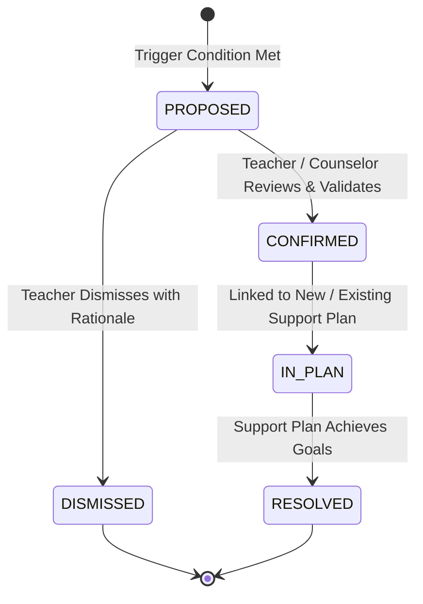

# Business Rules & Domain Logic

This document specifies the authoritative business rules, domain calculations, validation constraints, and state transition logic governing the **FSD-SDG-4 Quality Education SaaS** platform.

---

## 1. Academic Structure & Term Transitions (BR-SCH)

- **BR-SCH-001 (Single Active Year)**: A school tenant may have multiple academic years defined, but only **one** Academic Year may hold the status `ACTIVE` at any given time.
- **BR-SCH-002 (Enrollment Immutability)**: Students can only be enrolled in class sections belonging to the currently `ACTIVE` academic year. Once an academic year transitions to `COMPLETED` or `ARCHIVED`, enrollment rosters become read-only.
- **BR-SCH-003 (Course Offering Assignment)**: A Course Offering must associate exactly one Subject, exactly one Class Section, and at least one primary Teacher.

---

## 2. Attendance Business Rules (BR-ATT)

- **BR-ATT-001 (Unique Daily Record)**: For any given student and calendar date, there can exist at most **one** primary daily attendance record per section.
- **BR-ATT-002 (Permitted Statuses)**: Valid attendance status codes are strictly:
  - `PRESENT`: Student is physically present in the classroom.
  - `ABSENT`: Student is absent without prior authorized approval.
  - `LATE`: Student arrived after the designated start time (requires minute offset or note).
  - `EXCUSED`: Absence or tardiness authorized by school administration or medical note.
- **BR-ATT-003 (Teacher Amendment Window)**: Teachers may record or edit daily attendance for up to **5 calendar days** following the session. After 5 days, attendance records are locked and can only be amended by a School Administrator with an audit reason.
- **BR-ATT-004 (Attendance Rate Calculation)**:
  $$\text{Attendance Rate (\%)} = \frac{\text{Count}(\text{PRESENT}) + \text{Count}(\text{LATE})}{\text{Total School Days Recorded} - \text{Count}(\text{EXCUSED})} \times 100$$

---

## 3. Assignments, Submissions & Grading Rules (BR-ASN)

- **BR-ASN-001 (Submission Deadline Enforcement)**: Submissions received after the designated `due_date` are automatically marked with status `LATE`. The system preserves both the original submission timestamp and the deadline for teacher evaluation.
- **BR-ASN-002 (Score Bounds)**: A student's numerical assignment score must satisfy $0 \le \text{Score} \le \text{Max Points}$. Bonus points exceeding max points require explicit teacher override confirmation.
- **BR-ASN-003 (Feedback Requirement)**: When a teacher assigns a score below 50% on an assignment, the system strongly prompts for qualitative pedagogical feedback to explain learning gaps.

---

## 4. Student Support Flags: Deterministic Trigger Rules (BR-FLG)

Support flags are early warning signals generated by objective system rules. **They are strictly advisory and require human confirmation.**

- **BR-FLG-001 (Chronic Absenteeism Trigger)**:
  - *Condition*: Rolling 30-day attendance rate falls below **75%**, OR student accumulates **3 consecutive unexcused absences**.
  - *Flag Type*: `ATTENDANCE_RISK`
  - *Generated Rationale*: *"Student Amina has an attendance rate of 68% over the past 30 days with 4 unexcused absences."*
- **BR-FLG-002 (Missing Coursework Trigger)**:
  - *Condition*: Student accumulates **3 or more overdue/unsubmitted assignments** across enrolled subjects within a 14-day window.
  - *Flag Type*: `ACADEMIC_ENGAGEMENT_RISK`
  - *Generated Rationale*: *"Student has 3 unsubmitted assignments in Mathematics and Science due between Oct 10 and Oct 24."*
- **BR-FLG-003 (Academic Performance Dip Trigger)**:
  - *Condition*: Weighted average across the last 3 formal assessments falls below **50%**, OR drops by **$\ge 20$ percentage points** compared to the prior term.
  - *Flag Type*: `ACADEMIC_MASTERY_RISK`
  - *Generated Rationale*: *"Assessment average dropped from 72% to 48% across recent Unit Assessments."*

---

## 5. Support Flag Lifecycle & Human Review Rules (BR-REV)

- **BR-REV-001 (Human Review Mandatory)**: No support flag may transition from `PROPOSED` to `CONFIRMED` without an explicit human review action by a Teacher or Administrator.
- **BR-REV-002 (Dismissal Justification)**: If an educator marks a flag as `DISMISSED`, the system requires a mandatory text rationale (e.g., *"Student was hospitalized with verified medical excuse"*).
- **BR-REV-003 (No Permanent Stigmatization)**: Support flags are operational coordination markers for the active academic term. Dismissed or resolved flags are archived and excluded from student public transcripts.

---

## 6. Support Plans & Intervention Cycles (BR-PLN)

- **BR-PLN-001 (Assigned Case Lead)**: Every Support Plan must have an assigned Lead Educator (Teacher or School Counselor) responsible for coordination.
- **BR-PLN-002 (SMART Target Goals)**: A Support Plan must define at least one measurable goal (e.g., *"Achieve $\ge 85\%$ attendance in November"* or *"Complete 4 remedial algebra worksheets"*).
- **BR-PLN-003 (Actionable Steps)**: Support Plans must specify assigned action items with due dates.
- **BR-PLN-004 (Mandatory Review Cadence)**: Every Support Plan must specify a formal `review_date` no further than **30 calendar days** from creation.
- **BR-PLN-005 (Review Outcomes)**: Upon reaching the review date, the Lead Educator must record one of three outcomes:
  - `RESOLVED`: Goals met; support plan successfully closed.
  - `CONTINUED`: Progress observed; plan extended for another 14–30 days with revised goals.
  - `ESCALATED`: Learning gaps persist; escalated to School Administrator or specialist counselor.
