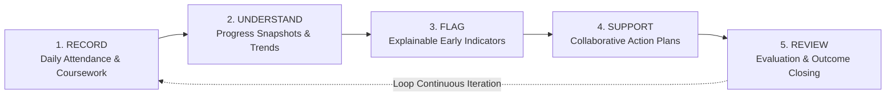

# Product Overview: FSD-SDG-4 Quality Education SaaS

## 1. Vision and Mission

The **FSD-SDG-4 Quality Education SaaS** platform is dedicated to advancing the United Nations Sustainable Development Goal 4: _“Ensure inclusive and equitable quality education and promote lifelong learning opportunities for all.”_

In many contemporary educational systems—particularly in resource-constrained environments—routine school administrative management is severely disconnected from student well-being and academic intervention. Schools record attendance in paper ledgers or standalone spreadsheets, grades are computed at the end of terms when it is too late to intervene, and struggling students quietly fall behind without systematic notice or support.

FSD-SDG-4 bridges this critical gap. It is an integrated, multi-tenant cloud application that connects routine day-to-day educational operations directly to meaningful, transparent, and collaborative student support.

---

## 2. The Core Closed Loop

The architectural and pedagogical heart of the platform is a continuous, five-stage closed loop:

$$\mathbf{RECORD} \longrightarrow \mathbf{UNDERSTAND} \longrightarrow \mathbf{FLAG} \longrightarrow \mathbf{SUPPORT} \longrightarrow \mathbf{REVIEW}$$

### Stage 1: RECORD (Zero-Friction Daily Operations)

- **What happens**: Teachers and school staff quickly record essential academic data: daily section attendance, course syllabus milestones, digital learning resources, assignment submissions, and assessment grades.
- **Design focus**: Minimal operational overhead. A teacher must be able to record attendance for a 30-student classroom on a low-end mobile phone in under 90 seconds.

### Stage 2: UNDERSTAND (Contextual Progress Synthesis)

- **What happens**: The system aggregates longitudinal records into real-time student progress profiles. Instead of fragmented scorecards, teachers see holistic patterns: attendance trajectories, assignment submission consistency, and weighted academic mastery.
- **Design focus**: Clarity and accessibility. Avoid dense, confusing dashboards; present simple, high-signal progress indicators.

### Stage 3: FLAG (Explainable, Human-Reviewed Early Indicators)

- **What happens**: Objective, deterministic thresholds evaluate student risk factors (e.g., attendance dropping below 75%, multiple consecutive unsubmitted assignments, failing grade trajectories).
- **Design focus**: **Transparency and Ethics**. A flag is **never** an automated diagnostic label, a permanent mark on a student’s record, or an algorithmic penalty. Every flag generates an explicit, readable explanation (e.g., _"Flagged: 4 unexcused absences in the last 14 days and 2 overdue mathematics assignments"_). A human educator must review and validate the flag.

### Stage 4: SUPPORT (Actionable Intervention Plans)

- **What happens**: When a flag is validated, the teacher or counselor initiates a structured **Support Plan**. The plan defines SMART goals (Specific, Measurable, Achievable, Relevant, Time-bound), assigns a designated lead educator, and articulates clear action steps (e.g., peer tutoring, remedial worksheets, parental check-in, vision check).
- **Design focus**: Collaboration and accountability. Action items have assignees, due dates, and completion checkboxes.

### Stage 5: REVIEW (Outcome Evaluation and Continuous Feedback)

- **What happens**: At scheduled intervals (e.g., 2 to 4 weeks), the support team conducts a formal review. The educator assesses whether the student recovered, requires continued support, or needs an escalated intervention plan.
- **Design focus**: Closing the loop. Interventions are never abandoned; they are formally concluded with documented outcome reflections.

---

## 3. Product Principles

1. **Human Dignity & Non-Punitive Interventions**: Educational technology should empower learners and teachers, not surveil or shame them.
2. **Explainability Over Black-Box AI**: Every metric, flag, and calculation must be auditable and clearly explained in plain language.
3. **Equitable Accessibility (WCAG 2.2 AA)**: Designed for students and educators of all abilities, including screen-reader users and keyboard-only navigators.
4. **Resilience to Real-World Constraints**: Optimized for mobile devices, low-bandwidth 3G connections, and shared school computer labs.
5. **Rigorous Tenant Privacy**: Student academic data is institutional intellectual property and sensitive minor personal information; tenant data must remain strictly isolated.
