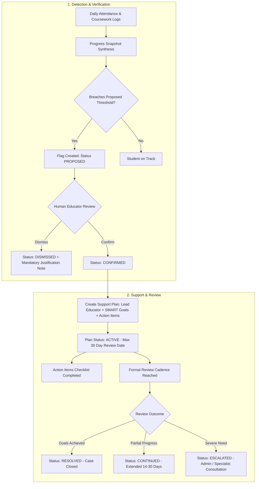

# Student Support Rules Validation & Governance

**Lifecycle Focus**: $\mathbf{RECORD} \longrightarrow \mathbf{UNDERSTAND} \longrightarrow \mathbf{FLAG} \longrightarrow \mathbf{SUPPORT} \longrightarrow \mathbf{REVIEW}$  
**Compliance Standard**: UN SDG-4 Ethical AI & Human-in-the-Loop Education Safeguards  
**Status**: Proposed Rules & Governance Framework — **Awaiting Institutional Stakeholder Approval**

---

## 1. Ethical Governance & Core Guardrails

The student support engine is designed to uphold the dignity and rights of learners. Under no circumstances may software algorithms replace human empathy, pedagogical discretion, or clinical assessment.

### Absolute Ethical Invariants

1. **Advisory, Not Diagnostic**: A system flag indicates an _operational opportunity for human educator support_. It is **never** a psychiatric diagnosis, a learning disability label, or a permanent disciplinary mark.
2. **Mandatory Human-in-the-Loop**: No automated flag may transition to an active intervention plan without explicit human educator confirmation.
3. **Transparent Evidence**: Every flag generated by the system must display its exact calculation inputs, dates, and baseline comparisons in plain, non-technical language.
4. **Non-Stigmatizing Record Keeping**: Support flags and intervention notes are confidential pastoral care records. They are excluded from public academic transcripts and external school transfer records.

---

## 2. Detailed Evaluation of Proposed Rule Triggers

> **CRITICAL POLICY NOTICE**:  
> The numerical thresholds below ($75\%$ attendance, $60\%$ completion, $15$ percentage-point dip) are **proposed initial baseline values** derived from educational literature. They are **NOT** approved production policy and must be formally ratified or calibrated by pilot school administrators during Phase 1 review.

---

### Rule 1: Attendance Risk Indicator (`FLAG-ATT-01`)

- **Proposed Trigger Condition**: Rolling 30-day attendance rate drops below **$75\%$**, OR student accumulates **$3$ consecutive unexcused absences**.
- **Measurement Period**: Rolling 30 calendar days (evaluated daily at 18:00 local school time).
- **Formula Specification**:
  $$\text{Attendance Rate} = \frac{\text{Count}(\text{PRESENT}) + \text{Count}(\text{LATE})}{\text{Total School Days in Window} - \text{Count}(\text{EXCUSED})} \times 100$$
- **Treatment of Excused Absences**: Excluded completely from the denominator. A student hospitalized with 10 excused days is **not** penalized or flagged.
- **Treatment of Missing Data**: If a teacher fails to record attendance for a scheduled session, that day is omitted from calculation and logged as a teacher compliance warning, not a student absence.
- **Duplicate Flag Behavior**: If a student already has a `PROPOSED` or `CONFIRMED` attendance flag within the current 30-day window, no duplicate flag is generated; the existing flag's evidence log is appended.
- **Required Evidence Display**:  
  _"Flagged: Attendance rate 68% over past 30 days (4 unexcused absences on Oct 12, Oct 14, Oct 21, Oct 22; 1 late arrival on Oct 19)."_
- **Review and Dismissal**: Teacher reviews evidence. If unrecorded excuses exist, teacher records excuse and dismisses flag with mandatory rationale (_"Absences verified with parent due to bereavement"_).
- **Audit Requirement**: Flag generation, confirmation, or dismissal logged in `audit_logs` with actor ID and timestamp.

---

### Rule 2: Coursework Engagement Risk Indicator (`FLAG-ASN-01`)

- **Proposed Trigger Condition**: Coursework completion rate drops below **$60\%$**, OR student accumulates **$3$ or more unsubmitted assignments** across enrolled subjects within a 14-day window.
- **Measurement Period**: Rolling 14 calendar days across all active course offerings.
- **Formula Specification**:
  $$\text{Completion Rate} = \frac{\text{Count}(\text{SUBMITTED}) + \text{Count}(\text{LATE})}{\text{Total Assignments Due in Window}} \times 100$$
- **Treatment of Missing Submissions**: Unsubmitted assignments past the due date count as $0$ toward completion.
- **Treatment of Excused Assignments**: Teachers can mark an assignment as `EXCUSED` for a specific student, removing it from the denominator.
- **Duplicate Flag Behavior**: Consolidates active unsubmitted homework alerts into a single active flag per student.
- **Required Evidence Display**:  
  _"Flagged: 3 missing assignments in the past 14 days (Math Problem Set 2 due Oct 15; Science Lab Report due Oct 18; English Essay due Oct 22)."_
- **Support-Plan Ownership**: Lead assigned to the student's primary Homeroom Teacher or Academic Advisor.

---

### Rule 3: Academic Performance Dip Indicator (`FLAG-ASM-01`)

- **Proposed Trigger Condition**: Weighted assessment average drops by **$\ge 15$ percentage points** compared to the student's prior term baseline, OR current assessment average falls below **$50\%$**.
- **Measurement Period**: Current active academic term across all completed unit assessments and midterms.
- **Score-Comparison Baseline**: Student's historical cumulative GPA or final assessment average from the immediately preceding `COMPLETED` academic term.
- **Treatment of Missing Data**: If the student is newly admitted with no prior term history, the percentage-point drop rule is inactive; only the absolute $< 50\%$ threshold applies.
- **Required Evidence Display**:  
  _"Flagged: Assessment average dropped by 18 percentage points (Prior Term: 72% -> Current Term: 54% across 3 Unit Assessments)."_
- **Support-Plan Ownership**: Assigned to the subject teacher where the sharpest decline occurred, in consultation with the School Counselor.

---

## 3. The Intervention & Review Cycle

### Mandatory Support Plan Attributes

1. **Lead Educator**: Exactly one teacher or counselor responsible for case management.
2. **SMART Target Goals**: Specific, Measurable, Achievable, Relevant, and Time-bound (e.g. _"Attend 90% of scheduled classes in November and submit 2 remedial math problem sets"_).
3. **Action Items**: Discrete, assignable tasks with assigned owners (Educator, Student, Guardian) and concrete due dates.
4. **Enforced Review Date**: Automatically scheduled no further than **30 calendar days** from plan creation.

---

## 4. Open Support Policy Decisions Requiring Ratification

| Decision ID    | Policy Question                                                                             | Proposed Baseline                       | Options for Institutional Review                                                                              |
| :------------- | :------------------------------------------------------------------------------------------ | :-------------------------------------- | :------------------------------------------------------------------------------------------------------------ |
| **POL-SUP-01** | Should school-wide support flag thresholds be customizable per school tenant?               | Yes (Fixed defaults with admin config). | Option A: Hardcoded global thresholds across platform. Option B: Institutional tenant configurable bounds. |
| **POL-SUP-02** | At what stage does a support intervention become visible to parents?                        | When Support Plan is marked `ACTIVE`.   | Option A: Visible immediately on draft flag. Option B: Visible only upon confirmed Support Plan.           |
| **POL-SUP-03** | What is the maximum duration a Support Plan can remain in `ACTIVE` status without a review? | Strictly 30 calendar days.              | Option A: 14 days (intensive). Option B: 30 days (standard school month).                                  |
