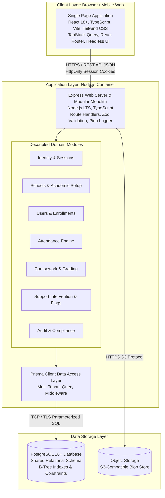

# Container and Component Architecture (C4 Level 2)

This document describes the C4 Level 2 Container Architecture for the **FSD-SDG-4 Quality Education SaaS** platform, detailing the high-level software containers, their responsibilities, technologies, and inter-container communication protocols.

---

## 1. Container Architecture Diagram

---

## 2. Container Descriptions and Roles

### 2.1 Single Page Application (Client Container)

- **Role**: Delivers the user interface across mobile, tablet, and desktop viewports. Responsible for rendering role-specific dashboards, client-side routing, accessible form interactions, and local state caching.
- **Technology**: React 18+, TypeScript (strict mode), Vite, Tailwind CSS, TanStack Query, React Hook Form, Zod.
- **Protocols**: Communicates with the Backend API exclusively over HTTPS using versioned RESTful JSON endpoints (`/api/v1/*`). Session identity is transmitted implicitly via `HttpOnly`, `Secure`, `SameSite=Lax` cookies.

### 2.2 Express Web Application (Modular Monolith Container)

- **Role**: Serves as the central API gateway, authentication authority, and business logic execution environment. Implements zero-trust request validation, tenant isolation scoping, RBAC checks, and transactional domain operations.
- **Technology**: Node.js (LTS), Express 4.x/5.x, TypeScript (strict), Pino structured logging, Zod validation schemas.
- **Internal Structure**: Organized into decoupled domain modules (`identity`, `schools`, `academics`, `attendance`, `coursework`, `support-intervention`, `audit`) communicating through typed internal service interfaces rather than cross-domain database tampering.

### 2.3 Prisma Data Access Layer

- **Role**: Mediates all database queries. Generates parameterized SQL queries, manages connection pooling, handles transactional rollback boundaries, and injects tenant-isolation filters (`school_id`) into query abstract syntax trees.
- **Technology**: Prisma ORM Client with custom multi-tenant extensions.

### 2.4 PostgreSQL Relational Database (Data Container)

- **Role**: Primary system of record for all structured institutional data, users, academic structures, attendance records, coursework grades, support plans, and audit entries.
- **Technology**: PostgreSQL 16+ with B-Tree indexes, composite tenant indexes, foreign key cascading rules, and check constraints.

### 2.5 Object Storage (Blob Container)

- **Role**: Stores uploaded binary documents (student assignment submissions, teacher course syllabus PDFs, images).
- **Technology**: S3-compatible cloud blob storage. The API generates pre-signed upload/download URLs with expiring signatures, ensuring private files are never publicly exposed.
