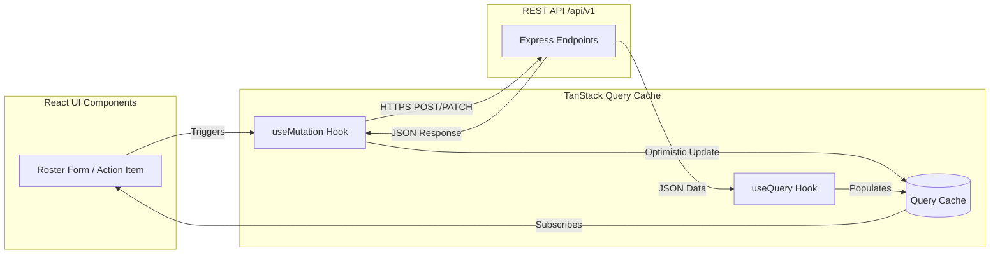

# Frontend Architecture and UI Strategy

This document specifies the frontend architecture, component design system, state management patterns, and accessibility framework for the **FSD-SDG-4 Quality Education SaaS** Single Page Application (SPA).

---

## 1. Architectural Philosophy and Technology Selection

The frontend is engineered as a high-performance, mobile-first, accessible Single Page Application. It avoids bloated component libraries and heavy client-side state engines in favor of lightweight, standard web primitives and server-state synchronization.

- **Framework**: React 19 (`19.3.1`) with strict TypeScript (`"strict": true`).
- **Build Engine**: Vite 8 (`8.3.6`, sub-second Hot Module Replacement, optimized ES module tree-shaking).
- **Styling**: Tailwind CSS v4 (`@tailwindcss/vite` + CSS-first `@theme` design tokens in `apps/web/src/styles/globals.css`).
- **Routing**: React Router v7 (`react-router-dom` `7.18.5`) for nested layouts, role-guarded route trees, and code-split route chunks.
- **Server-State Management**: TanStack Query (`@tanstack/react-query` `5.106.0`) for automatic caching, background refetching, mutation lifecycle, and optimistic UI updates.
- **Form Architecture**: React Hook Form (`7.91.0`) paired with Zod (`4.6.7`) schemas for zero-re-render form validation.
- **Accessibility**: Semantic HTML5 augmented with accessible headless primitives ensuring 100% WCAG 2.2 Level AA compliance.

---

## 2. Feature-Oriented Directory Structure (Monorepo Workspace: `apps/web/`)

> **Phase 4 Status**: The workspace shell exists at `apps/web/src/` with `App.tsx`, `main.tsx`, `styles/globals.css`, `components/feedback/ErrorBoundary.tsx`, `components/layout/AppShellPlaceholder.tsx`, and `pages/NotFoundPage.tsx`. Domain `features/` below will be populated in authorized implementation phases.

To ensure high cohesion and maintainability, the frontend source tree is structured around **business features** rather than generic technical types:

```text
apps/web/src/
├── app/                        # Application entry, providers, and global router configuration
│   ├── App.tsx
│   ├── routes.tsx              # Role-guarded route definitions
│   └── providers.tsx           # QueryClientProvider, ThemeProvider, AuthProvider
├── assets/                     # Optimized static SVGs, branding icons (no heavy assets)
├── components/                 # Shared, domain-agnostic UI primitives
│   ├── ui/                     # Accessible headless primitives: Button, Input, Modal, Table, Toast
│   ├── layout/                 # AppShell, Navbar, Sidebar, PageHeader, SkipToContent
│   └── feedback/               # EmptyState, LoadingSpinner, ErrorBoundary, ErrorBanner
├── features/                   # Domain feature modules (self-contained vertical slices)
│   ├── auth/                   # Login, session status, password reset
│   ├── schools/                # Tenant settings, academic years, classes, sections
│   ├── attendance/             # Daily roster grid, attendance history, bulk submit
│   ├── coursework/             # Learning resources, assignments, submissions, grading
│   ├── assessments/            # Gradebook overview, assessment result entry
│   ├── progress/               # Longitudinal student progress cards, metrics
│   ├── support-intervention/   # Support flags, human review modal, Support Plans, action items
│   └── dashboard/              # Role-tailored dashboards (Teacher, Admin, Student, Parent)
├── hooks/                      # Shared global hooks (useDebounce, useMediaQuery, useA11yAnnounce)
├── lib/                        # Client utilities, API client (fetch wrapper), date formatters
└── types/                      # Shared TypeScript domain contracts and API response types
```

---

## 3. Server-State and Client Data Flow



- **Server-State Authority**: All institutional educational data is owned by the server. TanStack Query acts as the client-side cache, eliminating the need for complex global state stores like Redux.
- **Optimistic Updates**: High-frequency teacher operations (such as toggling student attendance status or marking a support action item complete) apply optimistic cache updates for instantaneous UI feedback, rolling back gracefully if the API returns an error.

---

## 4. Accessibility and WCAG 2.2 AA Enforcement

1. **Focus Management**: Routing transitions announce view titles to screen readers and reset focus to the top-level `<h1>`. Modals and drawers implement strict focus trapping and restore focus to the triggering element upon dismissal.
2. **Keyboard Traps Prohibited**: Every interactive element is accessible via standard `Tab` and `Shift+Tab` keystrokes. Custom complex widgets (like the attendance roster grid) support arrow-key navigation.
3. **Contrast Verification**: Color tokens in `tailwind.config` enforce minimum $4.5:1$ contrast against light and dark backgrounds.
4. **Touch Target Sizing**: All touch targets on mobile viewports enforce $\ge 44 \times 44\text{ CSS pixels}$ (exceeding WCAG 2.2 AA's minimum 24px requirement).

---

## 5. Low-Bandwidth and Shared-Device Safeguards

- **Strict Bundle Budget**: Production build targets $< 250\text{ KB}$ gzipped. Heavy external dependencies are prohibited.
- **Route-Based Lazy Loading**: Feature modules (e.g., administrative settings, support plan authoring) are loaded on demand via `React.lazy()` and dynamic `import()`.
- **Shared-Device Privacy Shield**:
  - Logout clears all React Query cache entries (`queryClient.clear()`).
  - Session cookies are cleared via server-side expiration.
  - Form autocomplete is disabled on sensitive student evaluation fields.
