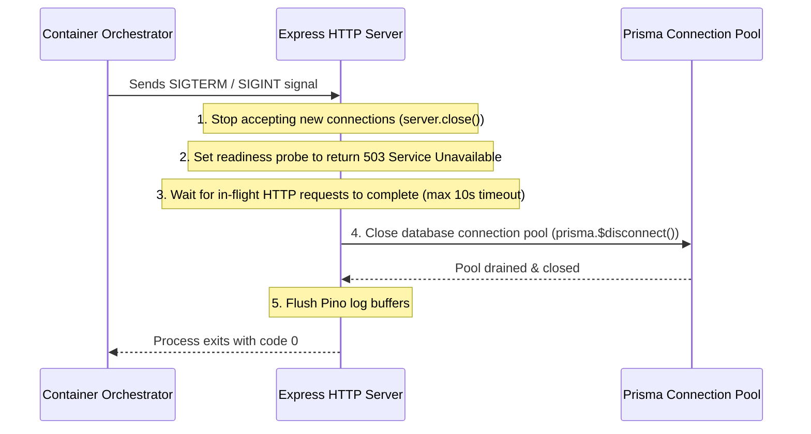

# Observability and Reliability Architecture

This document specifies the logging standards, health check probes, telemetry metrics, and graceful shutdown lifecycle for the **FSD-SDG-4 Quality Education SaaS** backend service.

---

## 1. Structured Logging Standards (Pino)

All logging in the application is standardized on **Pino**, outputting newline-delimited JSON to `stdout`.

### 1.1 Mandatory Context Attributes
Every log record emitted during HTTP request processing must include:
- `time`: Unix millisecond timestamp.
- `level`: Numeric log level (10=Trace, 20=Debug, 30=Info, 40=Warn, 50=Error, 60=Fatal).
- `reqId`: UUID v4 correlation ID propagated from `X-Request-Id` or generated upon entry.
- `tenantId`: Active institutional `school_id` from the session context (or `null` if unauthenticated).
- `userId`: Active `user_id` (or `null`).
- `role`: Role string (e.g., `TEACHER`, `SCHOOL_ADMIN`).
- `msg`: Clear, concise human-readable description of the event.

### 1.2 Data Sanitization (PII Masking)
Pino serializers automatically redact sensitive fields to prevent accidental leakage in logs:
- `password`, `confirmPassword`, `token`, `sessionToken`, `cookie`, `authorization`.
- Student identification records and private contact information.

---

## 2. Health Checks and Readiness Probes

The backend exposes two dedicated monitoring endpoints under `/api/v1`:

### 2.1 Liveness Probe (`GET /api/v1/health/liveness`)
- **Purpose**: Informs container orchestrators whether the Node.js event loop is alive.
- **Behavior**: Returns `200 OK` with `{ "status": "ok", "uptime": 3600 }`. Does not query the database.

### 2.2 Readiness Probe (`GET /api/v1/health/readiness`)
- **Purpose**: Verifies that the container is ready to accept user traffic (database connection established).
- **Behavior**: Executes `SELECT 1` via Prisma.
  - If successful: Returns `200 OK` with `{ "status": "ready", "database": "connected" }`.
  - If database is unreachable: Returns `503 Service Unavailable` with `{ "status": "not_ready", "database": "disconnected" }`.

---

## 3. Reliability & Graceful Process Shutdown

To prevent dropped requests and database transaction corruption during rolling updates or deployments, the Node.js server implements graceful termination:

- **In-Flight Draining**: An active timeout window ($10\text{ seconds}$) allows pending attendance or grade submissions to complete before forcing process exit.
- **Connection Draining**: Prisma client safely closes pooled PostgreSQL connections, preventing abandoned connection locks on the database server.
