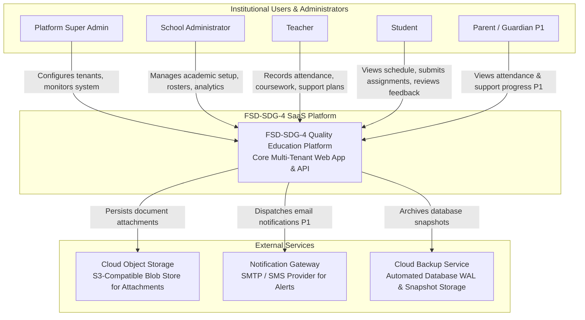

# System Context (C4 Level 1)

This document describes the C4 Level 1 System Context for the **FSD-SDG-4 Quality Education SaaS** platform, illustrating how the platform interacts with human actors and external systems.

---

## 1. Context Narrative

The FSD-SDG-4 platform sits at the center of institutional educational operations. It serves five distinct user personas across primary and secondary schools and integrates with a limited set of essential external services for storage and communications.

---

## 2. Actors & External System Descriptions

### 2.1 Primary Human Actors

1. **Platform Super Admin**: Configures system-wide parameters, provisions school tenants, monitors infrastructure health, and audits security telemetry.
2. **School Administrator**: Configures the institutional calendar, academic terms, courses, assigns teachers, enrolls students, and oversees institutional progress.
3. **Teacher**: Executes day-to-day academic workflows: taking morning attendance, publishing learning resources, setting and grading assignments, observing student trajectories, and leading Support Plans.
4. **Student**: Accesses learning resources, submits coursework digitally, tracks personal progress, and reviews constructive teacher feedback.
5. **Parent / Guardian (Priority P1)**: Views linked student attendance patterns, academic progress, and collaborative support goals.

### 2.2 External Supporting Systems

1. **Cloud Object Storage (S3-Compatible)**: Stores large student assignment submissions and teacher-uploaded PDF/DOCX learning resources, offloading binary payloads from the relational database.
2. **Notification Gateway (SMTP / SMS Provider - P1)**: Dispatches transactional emails (password reset tokens, school announcements) and critical guardian alerts (unexcused absences).
3. **Cloud Backup & Disaster Recovery Service**: Automatically archives daily database snapshots and continuous write-ahead logs (WAL) to secure, geographically separate cloud storage.
