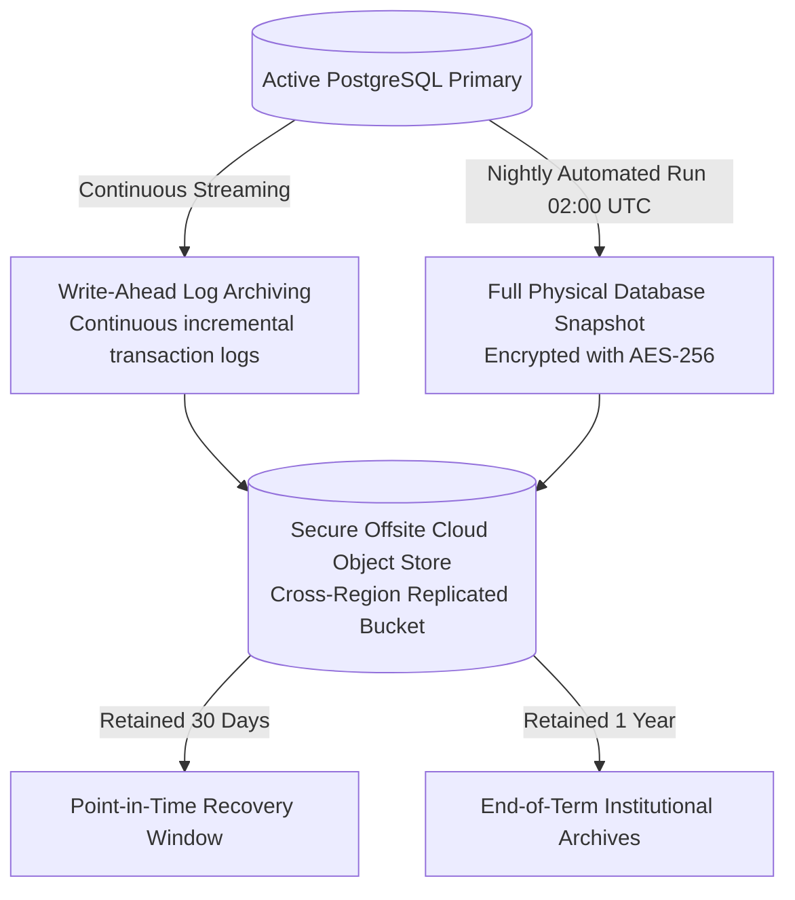

# Backup and Disaster Recovery Strategy

This document establishes the automated backup schedules, write-ahead log (WAL) archiving, disaster recovery procedures, and recovery objective thresholds for the **FSD-SDG-4 Quality Education SaaS** platform.

---

## 1. Disaster Recovery Objectives

- **Recovery Point Objective (RPO)**: **$\le 1\text{ hour}$**. In the event of a catastrophic storage failure, no more than 60 minutes of committed educational data may be lost.
- **Recovery Time Objective (RTO)**: **$\le 2\text{ hours}$**. The complete platform (database, application containers, DNS routing) must be restorable and accepting traffic within 120 minutes of declared outage.

---

## 2. Backup Architecture and Cadence

1. **Continuous Write-Ahead Log (WAL) Archiving**: PostgreSQL continuously ships compressed WAL segments to an off-site, cross-region S3-compatible bucket, enabling Point-in-Time Recovery (PITR) down to the specific minute.
2. **Nightly Full Snapshots**: Automated full database dumps or physical volume snapshots execute daily at 02:00 UTC during minimum school usage.
3. **Encryption at Rest**: All backup artifacts are encrypted using AES-256 before transmission and stored in a bucket configured with Object Lock (WORM - Write Once, Read Many) to prevent ransomware tampering.

---

## 3. Disaster Recovery Restoration Procedure

In the event of database corruption, accidental deletion, or primary cloud region outage:

1. **Phase 1: Incident Assessment & Freeze (T + 0 to 15 min)**:
   - Identify failure root cause; point traffic away from corrupted instance to a maintenance splash page.
2. **Phase 2: Target Instance Provisioning (T + 15 to 45 min)**:
   - Provision a fresh PostgreSQL 16+ instance in the recovery zone using automated infrastructure templates.
3. **Phase 3: Snapshot Restoration & PITR Replay (T + 45 to 90 min)**:
   - Restore the most recent healthy nightly snapshot.
   - Replay WAL archives up to the minute immediately preceding the corruption event.
4. **Phase 4: Integrity Verification (T + 90 to 105 min)**:
   - Execute verification script asserting database table row counts, foreign key integrity, and tenant isolation constraints.
5. **Phase 5: Traffic Cutover (T + 105 to 120 min)**:
   - Update `DATABASE_URL` in application container configuration; restart services; verify `/api/v1/health/readiness`; restore public traffic.

---

## 4. Disaster Recovery Testing Cadence

The engineering team will conduct a **semi-annual restoration dry run** in the staging environment. Yashwardhan will simulate an unexpected primary database wipe, execute the restoration playbook, and verify that actual restoration time satisfies the RTO $\le 2$ hours target.
