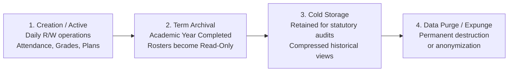

# Data Lifecycle and Retention Policy

This document defines the lifecycle states, archival strategies, soft-versus-hard deletion rules, and end-of-life data purging procedures for the **FSD-SDG-4 Quality Education SaaS** database (aligned with `deleted_at` and `status` columns in [`apps/api/prisma/schema.prisma`](file:///Users/viveksantoshkumarsingaraddi/FSD-SDG-4/apps/api/prisma/schema.prisma)).

---

## 1. Academic Data Lifecycle Stages

1. **Active Term State**: Records undergo daily transactional reads and updates. Full indexing and cache support enabled.
2. **Term Archival State**: When an `AcademicYear` transitions to `ARCHIVED`, all associated class rosters, course offerings, attendance logs, and student assignment submissions transition to **read-only status**. Records can still be queried for student transcripts, but mutations are blocked.
3. **Cold Storage State**: After 5 years of archival, detailed daily attendance and binary coursework attachments are moved to compressed cold storage tables or object stores to reclaim primary database storage.
4. **Permanent Purge State**: Expired audit logs ($> 90$ days) and closed support plans ($> 2$ years post-graduation) are permanently deleted via scheduled cron tasks.

---

## 2. Soft Deletion vs. Hard Deletion Discipline

To safeguard institutional record integrity and prevent accidental data loss:

| Entity Type                   |          Deletion Strategy          | Mechanism & Implementation                                                    | Rationale                                                                       |
| :---------------------------- | :---------------------------------: | :---------------------------------------------------------------------------- | :------------------------------------------------------------------------------ |
| **`User` / `StudentProfile`** |           **Soft Delete**           | Sets `deleted_at = NOW()`, `status = 'INACTIVE'`.                             | Preserves historical links on past attendance and assessment records.           |
| **`School` (Tenant)**         |   **Soft Delete (30-day Grace)**    | Sets `status = 'SUSPENDED'`, scheduled cascade hard delete after 30 days.     | Protects against accidental subscription cancellation.                          |
| **`Session`**                 |           **Hard Delete**           | Immediate `DELETE FROM sessions WHERE id = $1`.                               | Expired authentication credentials must not linger in the database.             |
| **`AttendanceRecord`**        | **No Deletion (Amended via Audit)** | Records cannot be deleted; corrected via `status` update + audit trail entry. | Legal requirement for student safety and truancy audits.                        |
| **`SupportFlag`**             |   **State Transition (Archive)**    | Marked as `DISMISSED` or `RESOLVED`; never physically deleted during term.    | Preserves justification trail explaining why intervention was or was not taken. |

---

## 3. Student Graduation and Departure Lifecycle

When a student graduates or transfers away from an institution:

1. Student account status updates to `GRADUATED` or `TRANSFERRED`.
2. Active sessions are terminated.
3. Student profile becomes read-only; historical grade transcripts remain accessible to administrators.
4. Active Support Plans are formally concluded with review notes (`RESOLVED` or `DISCONTINUED - TRANSFER`).
