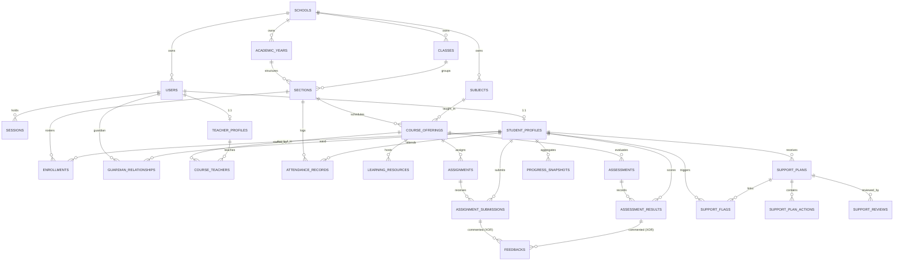

# Entity Relationships, Cardinality & Referential Integrity

This document defines the relational associations, cardinalities, cascade deletion policies, and referential integrity constraints governing the **FSD-SDG-4 Quality Education SaaS** data model (implemented in [`apps/api/prisma/schema.prisma`](file:///Users/viveksantoshkumarsingaraddi/FSD-SDG-4/apps/api/prisma/schema.prisma)).

## 0. Physical Entity-Relationship Diagram (Phase 5)

---

## 1. Cardinality and Relationship Catalog

### 1.1 One-to-One (1:1) Relationships

- `User` $\longleftrightarrow$ `StudentProfile`: Exactly one student profile per student user account. Optional for non-student roles. Foreign key `user_id` is unique.
- `User` $\longleftrightarrow$ `TeacherProfile`: Exactly one teacher profile per teacher user account. Optional for non-teacher roles. Foreign key `user_id` is unique.

### 1.2 One-to-Many (1:N) Relationships

- `School` $\longrightarrow$ `Users`, `AcademicYears`, `Classes`, `Subjects`, `AuditLogs`: A school tenant contains multiple users, terms, classes, and subjects.
- `AcademicYear` $\longrightarrow$ `Sections`, `Enrollments`, `CourseOfferings`: Academic terms structure classroom sections and scheduled courses.
- `Class` $\longrightarrow$ `Sections`: A grade level contains one or more section cohorts (e.g. 8-A, 8-B).
- `Section` $\longrightarrow$ `Enrollments`: A section contains enrolled student rosters.
- `Section` $\longrightarrow$ `AttendanceRecords`: Daily attendance records are registered per section.
- `CourseOffering` $\longrightarrow$ `LearningResources`, `Assignments`, `Assessments`: Course offerings contain instructional resources and coursework.
- `Assignment` $\longrightarrow$ `AssignmentSubmissions`: An assignment has multiple student submissions.
- `Assessment` $\longrightarrow$ `AssessmentResults`: A formal exam has multiple student results.
- `StudentProfile` $\longrightarrow$ `AttendanceRecords`, `AssignmentSubmissions`, `AssessmentResults`, `ProgressSnapshots`: A student accumulates longitudinal records.
- `StudentProfile` $\longrightarrow$ `SupportFlags`: A student may trigger multiple historical support flags.
- `StudentProfile` $\longrightarrow$ `SupportPlans`: A student may have active and historical Support Plans.
- `SupportPlan` $\longrightarrow$ `SupportPlanActions`: A support plan contains multiple concrete action items.
- `SupportPlan` $\longrightarrow$ `SupportReviews`: A support plan undergoes one or more formal review milestones.

### 1.3 Many-to-Many (M:N) Relationships (Modeled via Explicit Join Tables)

- `CourseOffering` $\longleftrightarrow$ `TeacherProfile` via `CourseTeacher`: Allows team-teaching or primary/assistant educator allocations.
- `User (Guardian)` $\longleftrightarrow$ `StudentProfile` via `GuardianRelationship`: Supports parents with multiple children and students with multiple guardians (P1).

---

## 2. Referential Integrity & Cascade Deletion Rules

| Parent Entity  | Child Entity           | Foreign Key Column | Cascade Policy | Integrity Justification                                                            |
| :------------- | :--------------------- | :----------------- | :------------- | :--------------------------------------------------------------------------------- |
| `School`       | _All Tenant Entities_  | `school_id`        | **CASCADE**    | Complete tenant offboarding purges all institutional child records cleanly.        |
| `User`         | `Session`              | `user_id`          | **CASCADE**    | Deleting a user immediately invalidates all active sessions.                       |
| `User`         | `StudentProfile`       | `user_id`          | **RESTRICT**   | Deleting a user account with academic history is blocked; must deactivate instead. |
| `AcademicYear` | `Section`              | `academic_year_id` | **RESTRICT**   | Academic years with active sections cannot be deleted; must be archived.           |
| `Section`      | `AttendanceRecord`     | `section_id`       | **RESTRICT**   | Sections with historical attendance cannot be dropped to preserve audit integrity. |
| `Assignment`   | `AssignmentSubmission` | `assignment_id`    | **RESTRICT**   | Assignments with submitted student work cannot be deleted; must be closed.         |
| `SupportPlan`  | `SupportPlanAction`    | `support_plan_id`  | **CASCADE**    | Deleting a draft support plan removes its associated action items.                 |
| `SupportPlan`  | `SupportReview`        | `support_plan_id`  | **CASCADE**    | Deleting a draft support plan removes its associated review records.               |
