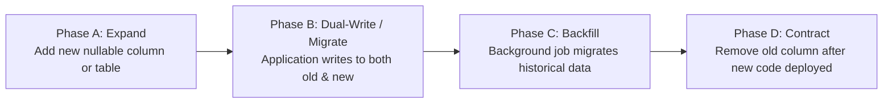

# Migration and Seeding Strategy

This document defines the schema migration lifecycle, zero-downtime evolution patterns, and synthetic seed data discipline for the **FSD-SDG-4 Quality Education SaaS** platform.

---

## 1. Schema Migration Discipline (Prisma ORM)

All database schema evolutions are managed via **version-controlled SQL migrations** generated through Prisma ORM (`prisma migrate`):

1. **Explicit SQL Review**: Developers never apply direct database changes. Every migration produces a timestamped SQL file under `prisma/migrations/` that must be reviewed by Database Lead Yashwardhan.
2. **Idempotence & Safety**: Migrations must execute cleanly within automated CI test runs without requiring manual intervention.
3. **Atomic Execution**: Prisma executes migrations inside PostgreSQL transactions. If a DDL statement fails, the entire migration rolls back cleanly.

---

## 2. Zero-Downtime Evolution: The Expand-and-Contract Pattern

In staging and production environments, migrations must avoid breaking in-flight application containers. We enforce the **Expand-and-Contract** pattern for destructive schema changes:

- **Adding Columns**: New columns must be defined as `NULL` or provide a database-level `DEFAULT` value.
- **Renaming Columns**: Direct column renames (`ALTER TABLE RENAME COLUMN`) lock tables and break running instances. Instead, add the new column, dual-write in the service layer, backfill data, and drop the deprecated column in a subsequent release.

---

## 3. Synthetic Seeding Strategy (Zero Real PII)

> **MANDATORY POLICY**:  
> Seed scripts must use **100% synthetic, procedurally generated data**. Real student, teacher, or parent names and credentials are never permitted in seed scripts.

### Deterministic Multi-Tenant Seed Profile (Implemented in `apps/api/prisma/seed.ts`)

The idempotent seed script [`apps/api/prisma/seed.ts`](file:///Users/viveksantoshkumarsingaraddi/FSD-SDG-4/apps/api/prisma/seed.ts) provisions 1 Platform Super Admin (`schoolId = null`) and three synthetic tenants using `.example.invalid` domains and placeholder hash `SYNTHETIC_DEV_HASH_NOT_FOR_PRODUCTION_USE`:

1. **Tenant 1: Greenfield Primary School (`SCH-GREENFIELD`)** — Active Academic Year `2026-2027`, Classes (`Grade 7`, `Grade 8`), Sections (`7-A`, `8-A`), Subjects (`MATH-101`, `SCI-101`), Course Offerings & Course Teachers, 1 School Admin, 2 Teachers, 2 Students + Enrollments, 1 Parent + GuardianRelationship, AttendanceRecords, LearningResource, Assignment + AssignmentSubmission + Feedback, Assessment + AssessmentResult, ProgressSnapshot, SupportFlags (`IN_PLAN` & `PROPOSED`), SupportPlan + SupportPlanAction + SupportReview.
2. **Tenant 2: Highcrest Secondary School (`SCH-HIGHCREST`)** — Active Academic Year `2026-2027`, Grade 9 (`9-A`), English Literature, 1 School Admin, 1 Teacher, 1 Student + Enrollment for cross-tenant isolation testing.
3. **Tenant 3: Empty Horizon Academy (`SCH-EMPTY`)** — Freshly registered school with 1 School Admin and zero enrollments to test empty states.
