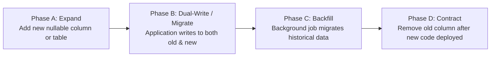

# Migration and Seeding Strategy

This document defines the schema migration lifecycle, zero-downtime evolution patterns, and synthetic seed data discipline for the **FSD-SDG-4 Quality Education SaaS** platform.

---

## 1. Schema Migration Discipline (Prisma ORM)

All database schema evolutions are managed via **version-controlled SQL migrations** generated through Prisma ORM (`prisma migrate`):

1. **Explicit SQL Review**: Developers never apply direct database changes. Every migration produces a timestamped SQL file under `prisma/migrations/` that must be reviewed by Database Lead Yashwardhan.
2. **Idempotence & Safety**: Migrations must execute cleanly within automated CI test runs without requiring manual intervention.
3. **Atomic Execution**: Prisma executes migrations inside PostgreSQL transactions. If a DDL statement fails, the entire migration rolls back cleanly.

---

## 2. Zero-Downtime Evolution: The Expand-and-Contract Pattern

In staging and production environments, migrations must avoid breaking in-flight application containers. We enforce the **Expand-and-Contract** pattern for destructive schema changes:

- **Adding Columns**: New columns must be defined as `NULL` or provide a database-level `DEFAULT` value.
- **Renaming Columns**: Direct column renames (`ALTER TABLE RENAME COLUMN`) lock tables and break running instances. Instead, add the new column, dual-write in the service layer, backfill data, and drop the deprecated column in a subsequent release.

---

## 3. Synthetic Seeding Strategy (Zero Real PII)

> **MANDATORY POLICY**:  
> Seed scripts must use **100% synthetic, procedurally generated data**. Real student, teacher, or parent names and credentials are never permitted in seed scripts.

### Deterministic Multi-Tenant Seed Profile
The seed script designed in Phase 5 will provision three standard synthetic tenants to support local development and automated testing:

1. **Tenant 1: Greenfield Primary School (`sch_greenfield`)**
   - 1 Academic Year (`2026-2027`, Active).
   - 4 Classes (Grade 5, 6, 7, 8) with 2 Sections each (8-A, 8-B).
   - 12 Teachers, 120 Students, 240 Guardian relationships.
   - 60 days of historical attendance with realistic variance ($\approx 92\%$ presence).
   - Complete coursework: 8 assignments, 3 unit assessments per course offering.
   - Active support interventions: 5 proposed support flags, 3 active Support Plans with action items.
2. **Tenant 2: Highcrest Secondary School (`sch_highcrest`)**
   - Baseline secondary school configuration for cross-tenant testing.
3. **Tenant 3: Empty Horizon Academy (`sch_empty`)**
   - Freshly registered school with zero enrollments to test empty states and onboarding wizards.
