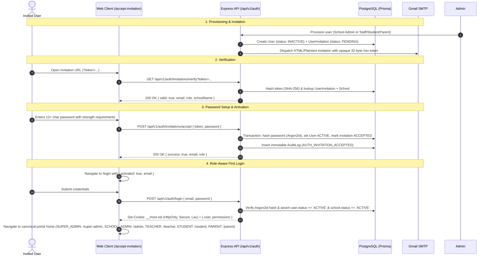

# API Authentication and Authorization Protocols

This document defines the protocols, cookie transport mechanisms, CSRF defenses, and authorization middleware pipelines governing client communication with the **FSD-SDG-4 Quality Education SaaS** API.

---

## 1. Client Credential Transport

- **Session Cookie (`sid`)**: Authenticated clients authenticate by delivering the `sid` cookie established during `POST /api/v1/auth/login`.
- **Fetch & Axios Settings**: Client requests must set `credentials: 'include'` (or `withCredentials: true` in Axios) on all HTTP requests to ensure session cookies are attached across origins.
- **Forbidden Bearer Tokens**: Client-side storage of bearer tokens in JavaScript accessible stores (`localStorage`, `sessionStorage`) is strictly prohibited.

---

## 2. Cross-Site Request Forgery (CSRF) Defenses

Because session authentication relies on automatic cookie submission by the browser, the platform implements a dual-layer CSRF defense:

1. **`SameSite=Lax` Cookie Policy**: Restricts browser submission of the session cookie during cross-site requests (e.g., third-party links or embedded malicious iframes).
2. **Custom Header Assertion**: All state-changing operations (`POST`, `PUT`, `PATCH`, `DELETE`) require the client to supply a custom header:  
   `X-Requested-With: XMLHttpRequest` (or standard `Content-Type: application/json`).  
   Standard browser HTML form submissions (`<form method="POST">`) cannot set custom HTTP headers without triggering a CORS preflight request, effectively neutralizing classic cross-origin form attacks.

---

## 3. Express Controller Middleware Authorization Pipeline

In the backend codebase, route authorization is declared declaratively via composable middleware:

```typescript
import { Router } from 'express';
import { authenticate } from '@/middleware/authenticate';
import { requireRole } from '@/middleware/requireRole';
import { validateRequest } from '@/middleware/validateRequest';
import { SubmitAttendanceSchema } from './attendance.schemas';
import { AttendanceController } from './attendance.controller';

const router = Router();

router.post(
  '/sections/:sectionId',
  authenticate, // 1. Validates session cookie & extracts tenant context
  requireRole(['TEACHER', 'SCHOOL_ADMIN']), // 2. Asserts user holds teacher or admin role
  validateRequest(SubmitAttendanceSchema), // 3. Validates Zod schema
  AttendanceController.submitSectionAttendance,
);

export default router;
```

If `authenticate` fails, it halts execution immediately and emits an RFC 7807 `401 Unauthorized` envelope. If `requireRole` fails, it returns `403 Forbidden`.

---

## 4. Account Activation & Invitation Acceptance Lifecycle

The platform uses a cryptographic, single-use invitation token model to securely onboard users across all five platform roles:



### Security Invariants for Activation

1. **Entropy & Storage**: 32 bytes of secure cryptographic entropy (`crypto.randomBytes(32)`). Only the SHA-256 hash is persisted in PostgreSQL; the raw token is never stored or logged.
2. **Single-Use & Invalidation**: Acceptance transitions the record to `status: ACCEPTED` and sets `acceptedAt: now()` inside a serializable database transaction. Repeated attempts reject with `400 Bad Request`.
3. **Tenant & Role Integrity**: The browser cannot supply or override `role` or `schoolId`. The activated user's role and tenant scoping are derived strictly from the pre-provisioned server-side record.
4. **Institution State Validation**: If the associated educational institution is inactive or suspended, verification returns `valid: false, reason: 'INVALID'` and acceptance is blocked.
5. **No Password Hashes or Sensitive Tokens in Client Memory**: Passwords are transmitted directly to the backend over TLS, hashed using Argon2id, and session cookies are set as `HttpOnly`. No tokens or hashes are stored in `localStorage` or `sessionStorage`.
