# Information Architecture and Navigational Model

**Phase**: `PHASE 2: Information Architecture, User Flows, and Screen Inventory`  
**Standard**: WCAG 2.2 Level AA / Mobile-First Responsive  
**Status**: Authoritative UX Blueprint for Phase 3 Visual Design & Frontend Architecture

---

## 1. Navigational Philosophy & Educational Mental Model

The information architecture of the **FSD-SDG-4 Quality Education SaaS** is organized directly around the core pedagogical and pastoral care loop:

$$\mathbf{RECORD} \longrightarrow \mathbf{UNDERSTAND} \longrightarrow \mathbf{FLAG} \longrightarrow \mathbf{SUPPORT} \longrightarrow \mathbf{REVIEW}$$

Rather than presenting an overwhelming enterprise ERP structure with fragmented menus, the platform organizes user tasks around **role-scoped, context-aware work hubs**. Every user interacts with a mental model customized to their immediate operational goals:

```text
┌────────────────────────────────────────────────────────────────────────────────────────┐
│ Global Shell Header: [School Brand] | [Active Academic Year] | [Quick Search] | [User] │
├────────────────────────┬───────────────────────────────────────────────────────────────┤
│ Role Navigation Rail   │ Contextual Workspace Canvas                                   │
│                        │ ┌───────────────────────────────────────────────────────────┐ │
│ • Dashboard (Home)     │ │ Breadcrumb Trail: Academic Year > Class 8 > Section 8-A   │ │
│ • Primary Operations   │ ├───────────────────────────────────────────────────────────┤ │
│ • Coursework / Tasks   │ │ Page Title & Contextual Status Badges                     │ │
│ • Student Support Hub  │ │ Global In-Page Action Toolbar: [Primary Action] [Filters] │ │
│ • Directory & Records  │ ├───────────────────────────────────────────────────────────┤ │
│ • Settings & Audit     │ │ Core Content: Responsive Grid / Card Deck / Data Matrix   │ │
│                        │ │                                                           │ │
│ [Sign Out Button]      │ └───────────────────────────────────────────────────────────┘ │
└────────────────────────┴───────────────────────────────────────────────────────────────┘
```

---

## 2. Core Architectural Pillars

### 2.1 Pillar 1: Academic Scoping Anchor

- **Temporal Anchor**: All student records, rosters, course offerings, attendance ledgers, and support plans are explicitly anchored to the **Active Academic Year** (e.g., `2026–2027`).
- **Archival Context Switcher**: Administrators and teachers can view historical terms via an explicit term selector dropdown in the header, which renders an immutable amber banner (_"Viewing Archived Term: 2025–2026 — Read-Only Mode"_).

### 2.2 Pillar 2: Classroom & Course Context Hierarchy

- For teachers and students, academic activity is structured hierarchically:
  $$\text{School Tenant} \longrightarrow \text{Academic Year} \longrightarrow \text{Class (Grade Level)} \longrightarrow \text{Section Cohort} \longrightarrow \text{Course Offering}$$
- Navigating to a section immediately surfaces three contextual workspaces:
  1. **Daily Attendance**: The morning attendance ledger and historical monthly records.
  2. **Coursework & Syllabus**: Active assignments, submissions queue, and learning resources.
  3. **Roster & Progress**: Enrolled learners with real-time academic and attendance risk indicators.

### 2.3 Pillar 3: Centralized Student Support Hub

- Pastoral care and academic intervention are elevated to a first-class top-level workspace.
- The **Support Hub** bridges daily tracking with intervention:
  - **Triage Queue**: Displays rule-generated, advisory `PROPOSED` early warning flags with plain-language evidence.
  - **Active Case Management**: Tracks formal Support Plans, assigned Lead Educators, SMART recovery goals, and action checklists.
  - **Milestone Reviews**: Schedules and captures formal review outcomes (`RESOLVED`, `CONTINUED`, `ESCALATED`).

---

## 3. Global Information Taxonomy

```mermaid
graph TD
    ROOT[FSD-SDG-4 Platform Root] --> AUTH[Authentication & Identity Hub]
    ROOT --> SCH[School Administration Hub]
    ROOT --> TCH[Teacher Classroom & Pastoral Hub]
    ROOT --> STU[Student Learner Portal]
    ROOT --> PAR[Parent / Guardian Portal - Provisional OQ-002]

    AUTH --> LOGIN[Login / Session Bootstrap]
    AUTH --> RESET[Out-of-Band Password Reset P1]
    AUTH --> LOGOUT[Instant Session Invalidation & Purge]

    SCH --> ACAD_YEAR[Academic Calendar & Term Transitions]
    SCH --> TAXONOMY[Classes, Sections & Curriculum Subjects]
    SCH --> ROSTERS[Staff Onboarding & Student Enrollment]
    SCH --> AUDIT[Immutable Audit Trail & Compliance]

    TCH --> TCH_DASH[Actionable Morning Dashboard]
    TCH --> ATTENDANCE[Section Attendance Roster Grid <= 90s]
    TCH --> COURSEWORK[Learning Resources, Assignments & Tests]
    TCH --> GRADEBOOK[Consolidated Tabular Gradebook Matrix]
    TCH --> SUPPORT_HUB[Support Flags Queue & Support Plan Lifecycle]

    STU --> STU_DASH[Mobile Dashboard: Next Classes & Deadlines]
    STU --> STU_COURSES[Subject Syllabi & Study Resources]
    STU --> STU_TASKS[Digital Homework Submission & Status]
    STU --> STU_FEEDBACK[Constructive Feedback & Personal Progress]

    PAR --> PAR_DASH[Child Summary & Attendance Calendar]
    PAR --> PAR_GOALS[Active Support Plan Goals & Milestones]
```



---

## 4. Navigation Depth and Task Efficiency Budgets

To ensure high teacher efficiency and mobile usability, strict navigation click-depth limits are enforced:

| Frequent Task                | Persona | Target Navigation Depth | Maximum Target Time | UX Path / Flow                                                              |
| :--------------------------- | :-----: | :---------------------: | :-----------------: | :-------------------------------------------------------------------------- |
| **Take Morning Attendance**  | Teacher |  **1 Click from Home**  |  $\le 90$ seconds   | Dashboard "Take Attendance" CTA $\to$ Interactive Roster Grid $\to$ Submit. |
| **Triage Support Flag**      | Teacher |  **1 Click from Home**  |  $\le 60$ seconds   | Dashboard Alert Badge $\to$ Flag Review Modal $\to$ Confirm / Dismiss.      |
| **Grade Submission**         | Teacher | **2 Clicks from Home**  |  $\le 120$ seconds  | Coursework $\to$ Assignment Queue $\to$ Grading Drawer $\to$ Submit Grade.  |
| **Submit Assignment**        | Student |  **1 Click from Home**  |  $\le 60$ seconds   | Dashboard "Due This Week" Card $\to$ Upload Modal $\to$ Submit.             |
| **Check Student Attendance** |  Admin  | **2 Clicks from Home**  |  $\le 30$ seconds   | Student Directory $\to$ Search Amina $\to$ Attendance Rate Card.            |

---

## 5. Breadcrumb & Contextual Location Model

Every view below the top-level dashboard renders a standardized accessible breadcrumb trail (`<nav aria-label="Breadcrumb">`):

```text
Home / Grade 8 / Section 8-A / Mathematics / Assignments / Fractions Problem Set 3 / Submissions
```

- Each segment is clickable and navigable via keyboard.
- The terminal segment represents the current page, marked with `aria-current="page"`.
- Mobile viewports ($< 640\text{px}$) collapse intermediate segments into a single _"Back to Section 8-A"_ parent link to preserve vertical screen space.

---

## 6. Global Search and Quick-Action Command Palette

- **Desktop Keyboard Shortcut**: `Cmd + K` (macOS) or `Ctrl + K` (Windows/Linux) opens the accessible Command Palette.
- **Search Capabilities**:
  - Direct student search: type `"Amina"` $\to$ jump immediately to Student Progress Profile.
  - Direct class section search: type `"8-A"` $\to$ jump directly to Section Roster or Morning Attendance.
  - Quick action commands: `"Take Attendance"`, `"New Assignment"`, `"Create Support Plan"`.
- **Tenant Scoping Guard**: Search queries are strictly executed against the active session's `school_id`; search results never leak entity names or IDs from other institutional tenants.
