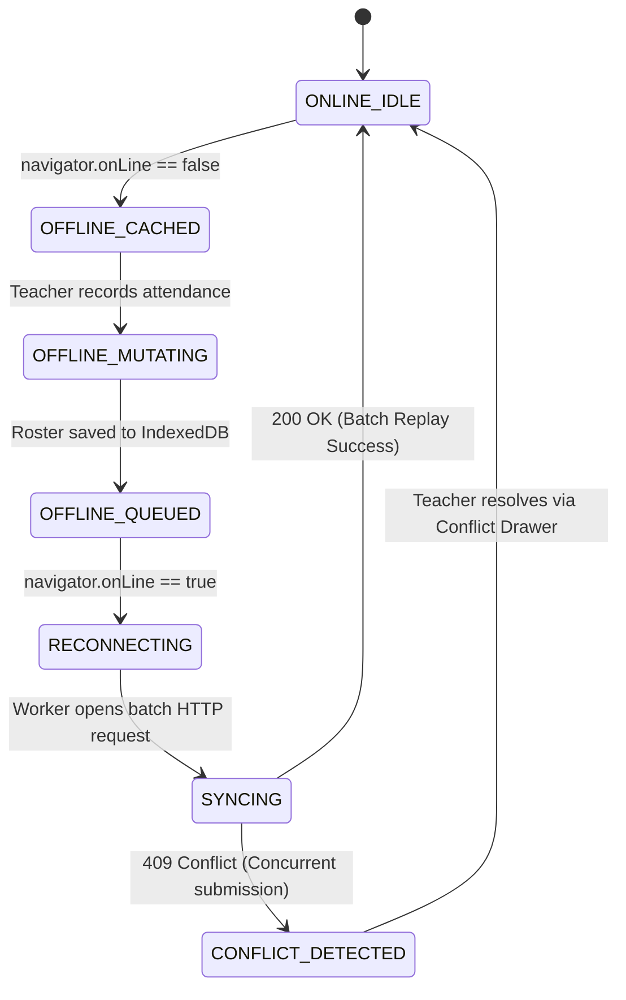

# Offline Attendance Synchronization: UX Architecture and Technical Trade-Offs (OQ-003)

This document provides the definitive UX architecture and technical trade-off evaluation for **OQ-003: Offline Attendance Synchronization User Flows & Reconciliation Strategy** for the **FSD-SDG-4 Quality Education SaaS** platform.

---

## 1. Context & The Educational Reality

In developing regions aligned with UN SDG-4, educational facilities frequently experience:

1. **Structural Signal Attenuation**: Thick concrete, stone, or brick walls that attenuate cellular signals within classrooms, despite strong signals in administrative offices.
2. **Intermittent Power & Connectivity**: Unannounced utility brownouts or 2G/3G mobile data drops.
3. **Shared Hardware**: A single school Android tablet passed between 4 to 6 educators throughout the school day.

A rigid "online-only" attendance system fails in this environment, forcing educators back to duplicate paper registers. **Offline tolerance for daily attendance is a critical P0 operational requirement**.

---

## 2. UX State Machine & Ambient Indicators

The client application transitions seamlessly between six distinct network and queue states:



### 2.1 Ambient Visual Indicators

| State              | Global Header Pill                           | Submit Button Microcopy       | User Notification                                       |
| :----------------- | :------------------------------------------- | :---------------------------- | :------------------------------------------------------ |
| **Online Idle**    | `[✓ Online]` _(Subtle green dot)_            | `[Submit Roster (32)]`        | None                                                    |
| **Offline Cached** | `[⚡ Offline — Standby]` _(Amber pill)_      | `[Save to Offline Queue]`     | Banner: _"You are offline. Changes are saved locally."_ |
| **Offline Queued** | `[⚡ Offline — 2 Rosters Queued]` _(Amber)_  | `[Save to Offline Queue]`     | Toast: _"Attendance saved to device queue."_            |
| **Reconnecting**   | `[🔄 Connecting to Server...]`               | Disabled _(Sync in progress)_ | None                                                    |
| **Syncing**        | `[🔄 Syncing 2 Records...]` _(Spinner)_      | Disabled                      | Accessible progress bar                                 |
| **Conflict**       | `[⚠️ 1 Sync Conflict]` _(High-contrast red)_ | `[Resolve Conflict]`          | Modal / Drawer auto-opens with discrepant rows          |

---

## 3. Local Storage Architecture & Security Isolation

### 3.1 Storage Mechanism Comparison

| Storage Technology   |    Storage Limit     |                  Structured Querying                  |                    Multi-Tenant Safety                    |   Verdict    |
| :------------------- | :------------------: | :---------------------------------------------------: | :-------------------------------------------------------: | :----------: |
| **`LocalStorage`**   | $\approx 5\text{MB}$ |           Synchronous string key-value only           |    High risk of thread-blocking & unencrypted exposure    | **REJECTED** |
| **`SessionStorage`** | $\approx 5\text{MB}$ |             Lost when browser tab closes              |    Will cause data loss if teacher closes tab offline     | **REJECTED** |
| **`IndexedDB`**      |   $> 50\text{MB}$    | Asynchronous, structured object stores, transactional | Supports structured queries, indices, and background sync | **ACCEPTED** |

### 3.2 Multi-Tenant & Shared-Tablet Security Rules

Because multiple teachers share the same tablet, storing unencrypted student rosters in IndexedDB poses severe privacy risks:

1. **Tenant & Session Binding**: Every record stored in IndexedDB must include `school_id`, `teacher_id`, and `session_hash`.
2. **Automatic Purge on Sign Out**: When an educator explicitly taps `[Sign Out]`, the client purges all decrypted local roster caches and unsubmitted drafts for that user.
3. **Queue Re-authentication**: If unsubmitted offline records exist when another teacher signs in, the system displays an ambient alert:
   > _"1 unsubmitted roster from Teacher Sarah Adams is queued. Please have Sarah sign in to finalize synchronization."_
   > The new teacher cannot view or tamper with Sarah's queued student data.

---

## 4. Conflict Resolution Strategy & Trade-Offs

### 4.1 The Conflict Scenario

- **08:30 AM**: Substitute Teacher Marcus logs into the school office desktop (online) and records Section 8-A attendance (marking Student #12 as `ABSENT`).
- **08:35 AM**: Homeroom Teacher Sarah, offline in the classroom, takes Section 8-A attendance (marking Student #12 as `LATE`, having seen them arrive at 08:32 AM).
- **10:15 AM**: Sarah walks into the staffroom Wi-Fi; background sync triggers.

### 4.2 Resolution Approaches Evaluated

```text
┌────────────────────────────────────────────────────────────────────────────────────────┐
│ Option A: Last-Write-Wins (LWW) based on Server Arrival Timestamp                      │
│ Rationale: Simplest technical implementation; whatever arrives last overwrites.       │
│ Flaw: Destroys Sarah's more accurate on-the-ground record; completely silent data loss.│
│ Verdict: REJECTED (Unacceptable for educational legal attendance records).             │
├────────────────────────────────────────────────────────────────────────────────────────┤
│ Option B: Strict Server Reject (Error on Conflict)                                     │
│ Rationale: Reject the sync request and delete local data.                              │
│ Flaw: Forces the teacher to re-enter the entire 32-student roster from memory.        │
│ Verdict: REJECTED (Hostile user experience).                                          │
├────────────────────────────────────────────────────────────────────────────────────────┤
│ Option C: Field-Level Reconciliation with Interactive Conflict Drawer (RECOMMENDED)   │
│ Rationale: Non-conflicting rows auto-merge; conflicting rows presented to educator.   │
│ Verdict: ACCEPTED (Preserves data integrity, human-in-the-loop, zero data loss).      │
└────────────────────────────────────────────────────────────────────────────────────────┘
```

### 4.3 Recommended Reconciliation Model: Interactive Conflict Drawer

```text
┌────────────────────────────────────────────────────────────────────────────────────────┐
│ Drawer: Attendance Reconciliation Required (Section 8-A • Oct 29)                      │
├────────────────────────────────────────────────────────────────────────────────────────┤
│ A different record was submitted for Section 8-A by Marcus Vance at 08:30 AM.          │
│ 31 student records matched and were synchronized. 1 discrepant record requires review: │
│                                                                                        │
│ Student: David Chen (#12)                                                              │
│ ┌──────────────────────────────────────┬─────────────────────────────────────────────┐ │
│ │ Office Record (Marcus Vance - 08:30) │ Your Classroom Record (Sarah Adams - 08:35) │ │
│ │ [ ABSENT ]                           │ [ LATE — Arrived 08:32 AM ]                 │ │
│ │ [Use This Record]                    │ [Use This Record (Recommended)]             │ │
│ └──────────────────────────────────────┴─────────────────────────────────────────────┘ │
│                                                                                        │
│ [Keep Your Version for All (1)]                        [Accept Office Record]          │
└────────────────────────────────────────────────────────────────────────────────────────┘
```

---

## 5. Architectural Recommendations for Phase 4 & Phase 10

1. **Service Worker Caching Policy**:
   - Static App Shell (HTML, CSS, JS, SVG icons): `CacheFirst` with background cache refresh.
   - Student Rosters (`GET /api/v1/sections/:id/roster`): `StaleWhileRevalidate` with a 24-hour expiration cap.
   - Attendance Submission (`POST /api/v1/attendance`): `NetworkOnly` with interception fallback to IndexedDB Queue.
2. **Sync Payload Schema**:
   ```typescript
   interface QueuedAttendancePayload {
     queueId: string; // UUID v4
     schoolId: string; // Tenant isolation key
     sectionId: string;
     date: string; // ISO Date YYYY-MM-DD
     teacherId: string;
     clientRecordedAt: string; // ISO Timestamp
     records: Array<{
       studentId: string;
       status: 'PRESENT' | 'ABSENT' | 'LATE' | 'EXCUSED';
       remarks?: string;
     }>;
     signature: string; // Client HMAC token
   }
   ```
3. **Non-Blocking Background Worker**:
   - Synchronization executes asynchronously in the background without freezing the UI or preventing teachers from navigating to other views.
   - Success triggers an unobtrusive toast notification: _"Section 8-A attendance synchronized."_
