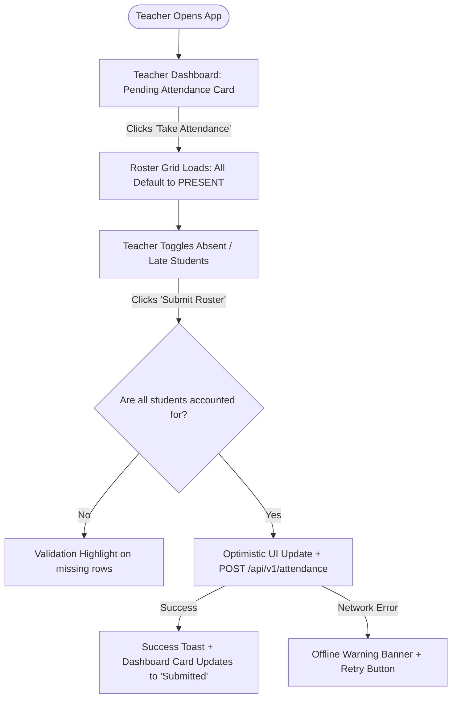
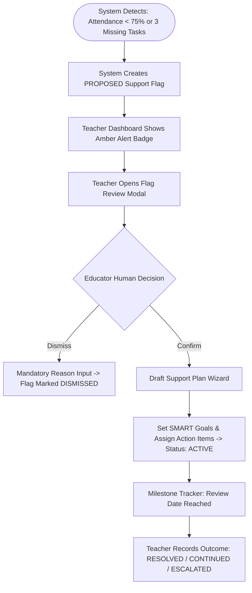

# User Flow Inventory and Interaction Journeys

This document details the interaction sequences, screen transitions, validation branches, and edge-case handling for the core user flows of the **FSD-SDG-4 Quality Education SaaS** platform.

---

## Flow UF-01: Morning Attendance Roster Entry & Amendment

- **Happy Path**: Teacher selects section $\to$ all 32 students default to `PRESENT` $\to$ teacher clicks student #4 to `ABSENT` $\to$ clicks student #12 to `LATE` $\to$ clicks *"Submit Roster"* $\to$ persistent state confirmed within $\le 90$ seconds.
- **Edge Case (Late Modification)**: Teacher amends an attendance record later in the day: opens *Attendance History Ledger* $\to$ updates student #4 from `ABSENT` to `EXCUSED` with reason note $\to$ change is saved and logged in the immutable audit table.

---

## Flow UF-02: Assignment Creation, Distribution & Digital Grading

1. **Authoring**: Teacher clicks *"New Assignment"* inside a Course Offering $\to$ inputs title, markdown instructions, max points ($50$), due date $\to$ attaches reference PDF.
2. **Distribution**: Teacher clicks *"Publish"* $\to$ assignment is immediately visible on student portals.
3. **Student Submission**: Student navigates to *Assignments* $\to$ clicks *"Submit Work"* $\to$ enters text or uploads file $\to$ clicks *"Confirm"*. System checks submission time against deadline and stamps status (`SUBMITTED` or `LATE`).
4. **Grading & Constructive Feedback**: Teacher opens *Grading Queue* $\to$ reviews student response in drawer $\to$ enters score ($42/50$) $\to$ inputs structured qualitative feedback $\to$ clicks *"Publish Grade"*. Student dashboard reflects updated grade and feedback card.

---

## Flow UF-03: The Closed Support Loop ($\text{Flag} \to \text{Plan} \to \text{Review}$)

- **Step 1: Transparent Early Warning**: System triggers a `PROPOSED` flag based on objective thresholds (e.g. 4 unexcused absences).
- **Step 2: Human Review Gate**: Teacher reviews the evidence. If the absence was pre-excused, teacher dismisses the flag with a note. If valid, teacher confirms the flag.
- **Step 3: Actionable Support Plan**: Teacher defines SMART goals and action items (e.g., peer tutor, guardian call).
- **Step 4: Milestone Evaluation**: On the review date, educator evaluates progress. If goals are met, the plan is marked `RESOLVED`. If gaps persist, the plan is updated or escalated.
