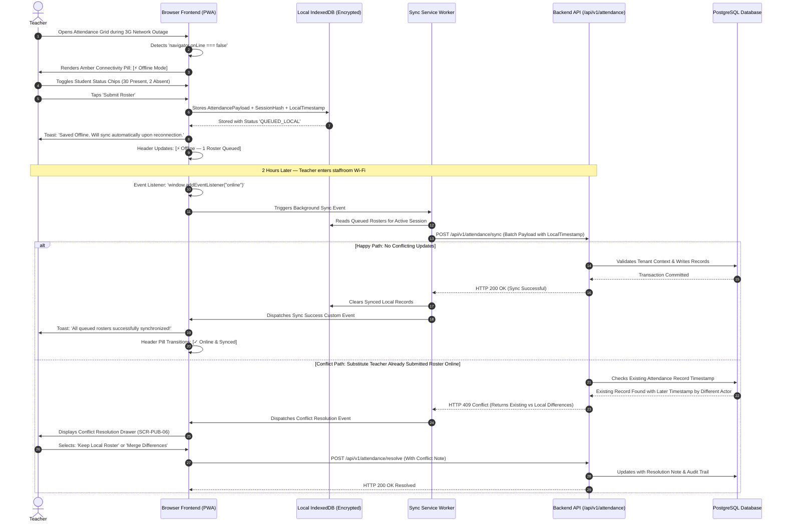

# User Flow Inventory and Interaction Journeys

This document details the complete end-to-end user journeys, screen transitions, decision trees, validation branches, and edge-case handling for the core user flows of the **FSD-SDG-4 Quality Education SaaS** platform.

All flows are anchored in the core educational closed loop:
$$\text{RECORD} \longrightarrow \text{UNDERSTAND} \longrightarrow \text{FLAG} \longrightarrow \text{SUPPORT} \longrightarrow \text{REVIEW}$$

---

## 1. Flow UF-01: Morning Attendance Roster Entry & Amendment

### 1.1 Persona & Context

- **Actor**: Class Teacher (Mrs. Sarah Adams).
- **Environment**: Noisy classroom with 32 students; tablet or mobile device; time budget: $\le 90$ seconds.

### 1.2 Journey Flowchart

```mermaid
flowchart TD
    Start([Teacher Enters Classroom]) --> OpenApp[Opens App on Mobile / Tablet]
    OpenApp --> AuthCheck{Session Valid?}
    AuthCheck -- No --> Login[Fast Passcode / Session Re-auth]
    AuthCheck -- Yes --> Dash[Teacher Dashboard: SCR-TCH-01]
    Login --> Dash
    Dash --> PendingCard{Pending Attendance Alert Visible?}
    PendingCard -- Yes --> TapTake[Tap 'Take Attendance' on Active Section]
    PendingCard -- No --> NavMenu[Navigate via Classes Menu or Cmd+K]
    NavMenu --> TapTake
    TapTake --> RosterGrid[Morning Attendance Grid: SCR-TCH-02 Loads]
    RosterGrid --> AutoDefault[All 32 Students Default to 'PRESENT' Status]
    AutoDefault --> SpotExceptions[Teacher Visual Scan: Identifies Absences]
    SpotExceptions --> ToggleChips[Tap Student #5 -> ABSENT<br>Tap Student #14 -> LATE]
    ToggleChips --> Remarks{Add Excuse Reason?}
    Remarks -- Yes --> QuickNote[Tap Remark Icon -> Select 'Doctor Note']
    Remarks -- No --> CheckCounts[Verify Summary: 30 Present, 1 Absent, 1 Late]
    QuickNote --> CheckCounts
    CheckCounts --> TapSubmit[Tap Sticky Bottom 'Submit Roster (32)']
    TapSubmit --> ValidCheck{All rows accounted for?}
    ValidCheck -- No --> HighlightMissing[Highlight Unmarked Row with Amber Outline]
    ValidCheck -- Yes --> NetworkCheck{Device Online?}
    NetworkCheck -- Online --> PostAPI[POST /api/v1/attendance]
    NetworkCheck -- Offline --> QueueLocal[Save to Encrypted IndexedDB Queue (UF-02)]
    PostAPI --> PostSuccess{HTTP 200 OK?}
    PostSuccess -- Yes --> ToastSuccess[Accessible Toast: 'Attendance Recorded Successfully']
    PostSuccess -- Error --> NetworkFail[Show Retry Banner + Fallback to Local Queue]
    ToastSuccess --> DashReturn[Dashboard Status Updates to 'Submitted' with Green Check]
    QueueLocal --> OfflinePill[Header Displays: 'Offline — 1 Roster Queued']
```

### 1.3 Step-by-Step Task Timing Verification

| Sequence Step            | Interaction Target                                                 | Cognitive / Motor Load                     |                 Cumulative Time                 |
| :----------------------- | :----------------------------------------------------------------- | :----------------------------------------- | :---------------------------------------------: |
| 1. Launch App            | Mobile browser homescreen PWA icon                                 | 1 tap                                      |             $0\text{s} - 3\text{s}$             |
| 2. Dashboard Arrival     | Top pending banner: _"Take Attendance (Grade 8-A)"_                | 1 glance, 1 tap                            |             $4\text{s} - 7\text{s}$             |
| 3. Roster Population     | 32 student rows loaded with optimistic default (`PRESENT`)         | 0 taps (automated default)                 |            $8\text{s} - 10\text{s}$             |
| 4. Exception Marking     | Teacher taps Student #4 (`ABSENT`), Student #12 (`LATE`)           | 2 taps (large $48\text{px}$ touch targets) |            $11\text{s} - 25\text{s}$            |
| 5. Verification          | Sticky bottom action bar displays _"30 Present, 1 Absent, 1 Late"_ | 1 glance                                   |            $26\text{s} - 35\text{s}$            |
| 6. Roster Submission     | Teacher taps _"Submit Roster (32 Students)"_                       | 1 thumb tap                                |            $36\text{s} - 40\text{s}$            |
| 7. Feedback Confirmation | Toast confirms submission; dashboard reflects green check          | Automated confirmation                     | $\mathbf{42\text{s} \le 90\text{s}}$ **(PASS)** |

### 1.4 Edge Case: Historical Attendance Amendment

When a parent brings an excused absence slip later in the afternoon:

1. Teacher opens `/teacher/classes/:sectionId/attendance/history` (`SCR-TCH-03`).
2. Selects date $\to$ locates student $\to$ changes status from `ABSENT` to `EXCUSED`.
3. Modal requests mandatory reason note (_"Medical certificate verified by nurse"_).
4. Submits amendment $\to$ change updates daily percentage and logs a cryptographic audit event in `audit_logs` tracking teacher ID, timestamp, and previous vs new value.

---

## 2. Flow UF-02: Offline Attendance Entry, Local Queuing & Reconciliation (OQ-003)

### 2.1 Persona & Context

- **Actor**: Rural School Teacher in courtyard or basement classroom with intermittent 2G/3G connectivity drops.

### 2.2 Sequence Diagram



---

## 3. Flow UF-03: Assignment Creation, Distribution & Digital Grading Drawer

### 3.1 Persona & Context

- **Actor**: Science Educator grading a Grade 8 Lab Report; requires rapid keyboard navigation between submissions.

### 3.2 Interaction Sequence Flowchart

```mermaid
flowchart TD
    Start([Teacher in Course View]) --> NewBtn[Clicks 'New Assignment': SCR-TCH-06]
    NewBtn --> FormInput[Enters Title, Markdown Instructions, Max Points: 50, Due Date]
    FormInput --> AttachRubric[Attaches Evaluation Rubric PDF]
    AttachRubric --> PublishClick[Clicks 'Publish Assignment']
    PublishClick --> Distribute[System Distributes to all 32 Student Dashboards]

    subgraph Student Journey
        Distribute --> StuView[Student Dashboard Alert: SCR-STU-01]
        StuView --> StuOpen[Opens Assignment: SCR-STU-04]
        StuOpen --> StuDraft[Types Text Response / Attaches PDF Report]
        StuDraft --> StuSubmit[Clicks 'Submit Work': SCR-STU-05]
        StuSubmit --> CheckTime{Submitted before Due Date?}
        CheckTime -- Yes --> OnTime[Status: SUBMITTED]
        CheckTime -- No --> Late[Status: LATE]
    end

    subgraph Grading Workflow
        OnTime & Late --> GradeQueue[Teacher Opens Grading Queue: SCR-TCH-07]
        GradeQueue --> SelectRow[Selects Student Row: Jane Doe]
        SelectRow --> OpenDrawer[Drawer SCR-TCH-08 Slides In from Right Canvas]
        OpenDrawer --> InspectDoc[Teacher Reviews PDF Preview & Text Response]
        InspectDoc --> EnterScore[Inputs Numeric Score: 44 / 50]
        EnterScore --> EnterFeedback[Inputs Constructive Feedback: 'Excellent analysis of photosynthesis...']
        EnterFeedback --> HotkeyNext{Teacher Presses 'Cmd+Enter' or Clicks 'Save & Next'}
        HotkeyNext --> SaveAPI[API Saves Grade Mutation Optimistically]
        SaveAPI --> NextStudent[Drawer Instantly Loads Student #2: John Smith]
    end
    NextStudent --> CompletedAll{All 32 Submissions Graded?}
    CompletedAll -- Yes --> CloseDrawer[Drawer Closes; Toast: 'Grading Complete!']
    CompletedAll -- No --> InspectDoc
```



---

## 4. Flow UF-04: The Closed Support Loop ($\text{Flag} \to \text{Plan} \to \text{Review}$)

### 4.1 Persona & Context

- **Actor**: Pastoral Care Lead / Homeroom Teacher managing early academic and attendance interventions.

### 4.2 Interaction Flowchart

```mermaid
flowchart TD
    subgraph 1. Early Warning Trigger
        Cron([Nightly Background Job / Event Trigger]) --> EvalRules{Evaluate Business Rules}
        EvalRules -->|BR-ATT-02: Rate < 75% or 3 Unexcused Absences| GenAttFlag[Create Flag: ATTENDANCE_CONCERN]
        EvalRules -->|BR-ACAD-04: 3 Consecutive Missing Submissions| GenAcadFlag[Create Flag: ACADEMIC_DISENGAGEMENT]
        GenAttFlag & GenAcadFlag --> Propose[Status: PROPOSED with Transparent Evidence String]
    end

    subgraph 2. Human Review Gate
        Propose --> AmberAlert[Teacher Dashboard: Amber Warning Badge (3)]
        AmberAlert --> OpenQueue[Teacher Navigates to Support Queue: SCR-TCH-11]
        OpenQueue --> ReviewCard[Teacher Inspects Flag Evidence & Absence Dates]
        ReviewCard --> HumanDecision{Educator Professional Assessment}
        HumanDecision -- False Positive / Excused --> Dismiss[Clicks 'Dismiss Flag']
        Dismiss --> DismissModal[SCR-TCH-12: Mandatory Justification Note >= 15 chars]
        DismissModal --> FlagDismissed[Flag Marked DISMISSED; Logged in Audit Trail]
        HumanDecision -- Valid Concern --> Confirm[Clicks 'Confirm Flag & Create Support Plan']
    end

    subgraph 3. SMART Support Plan
        Confirm --> LaunchWizard[Support Plan Creator Wizard: SCR-TCH-13]
        LaunchWizard --> SetSMART[Defines Specific Goal: 'Achieve 90% attendance over next 4 weeks']
        SetSMART --> AssignActions[Assigns Action Items: '1. Peer study buddy, 2. Weekly parent call']
        AssignActions --> SetMilestone[Sets Mandatory Milestone Review Date: 28 Days]
        SetMilestone --> ActivatePlan[Clicks 'Activate Plan' -> Status: ACTIVE]
        ActivatePlan --> StuNotify[Student Progress View Shows Positive Goal: SCR-STU-06]
    end

    subgraph 4. Milestone Evaluation
        ActivatePlan --> ReviewClock[Review Milestone Date Reached]
        ReviewClock --> MilestoneAlert[Teacher Notification: 'Milestone Review Due for Jane Doe']
        MilestoneAlert --> OpenCase[Teacher Opens Support Plan Case View: SCR-TCH-14]
        OpenCase --> CheckTasks[Inspects Completed Action Items (3 of 4 Done)]
        OpenCase --> LaunchReview[Launches Milestone Review Modal: SCR-TCH-15]
        LaunchReview --> OutcomeSelect{Outcome Evaluation}
        OutcomeSelect -- Goals Met --> Resolved[Mark RESOLVED: Celebration Badge Issued]
        OutcomeSelect -- In Progress --> Continued[Mark CONTINUED: Next Review Scheduled in 21 Days]
        OutcomeSelect -- Concern Deepened --> Escalated[Mark ESCALATED: Referred to School Principal / Counselor]
    end
```

---

## 5. Flow UF-05: Student Coursework Submission and Feedback Review (Mobile-First)

### 5.1 Persona & Context

- **Actor**: Grade 8 Student (Jane Doe) accessing school platform from home on an entry-level smartphone.

### 5.2 Step-by-Step Flow

1. **Home Screen Notification**: Jane sees badge on _Tasks_ tab; opens `/student/dashboard` (`SCR-STU-01`).
2. **Task Prioritization**: Top banner displays: _"Math Homework: Linear Equations — Due Today at 5:00 PM (3 hours left)"_.
3. **Open Submission View**: Taps card $\to$ opens `/student/assignments/:id/submit` (`SCR-STU-05`).
4. **Drafting Work**:
   - Types answers into accessible markdown editor.
   - Or taps _"Upload Photo / PDF"_ $\to$ uses smartphone camera to capture photo of handwritten worksheet.
   - Image compression runs client-side (resizes to $\le 1920\text{px}$, reduces file from $6\text{MB}$ to $380\text{KB}$ before upload).
5. **Confirmation & Submit**: Taps sticky thumb button _"Submit Assignment"_.
6. **Double Confirmation Sheet**: Sheet confirms: _"You are submitting 1 file: math_hw.jpg. You can re-submit until 5:00 PM."_ Jane taps _"Confirm Submit"_.
7. **Success Feedback**: Confetti micro-animation; badge updates to green check: _"Submitted On Time — Oct 29, 2:14 PM"_.
8. **Feedback Loop (2 Days Later)**: Jane receives notification $\to$ opens `/student/assignments` (`SCR-STU-04`) $\to$ views score ($46/50$) and teacher comment (_"Great work Jane! Watch the negative sign in Question 4."_).

---

## 6. Flow UF-06: School Setup & Academic Term Rollover (School Admin)

### 6.1 Persona & Context

- **Actor**: School Administrator (Principal Robert Vance) setting up a new academic year.

### 6.2 Administrative Setup Sequence

1. **Academic Year Setup**: Navigates to `/school/academic-years` (`SCR-ADM-02`) $\to$ creates _"2026-2027 Academic Year"_.
2. **Terms Creation**: Adds _"Term 1 (Aug 15 - Dec 20)"_, _"Term 2 (Jan 10 - Apr 30)"_, _"Term 3 (May 10 - Jul 15)"_.
3. **Classes & Sections**: Navigates to `/school/classes` (`SCR-ADM-03`) $\to$ sets up Grade Levels 7, 8, 9 with Sections A, B, C.
4. **Curriculum Subjects**: Enters subjects into `/school/subjects` (`SCR-ADM-04`) with code prefixes (`MATH-7`, `SCI-7`).
5. **Course Allocations**: Assigns teacher Sarah Adams to `Grade 8 Math` and `Section 8-A` in `/school/offerings` (`SCR-ADM-05`).
6. **Student Admissions**: Enrolls cohort of 90 students into Section rosters (`SCR-ADM-07`).
7. **Term Transition Activation**: Administrator clicks _"Activate Term 1"_. System checks prerequisites (teachers assigned, dates non-overlapping) $\to$ status transitions to `ACTIVE` $\to$ teacher dashboards unlock today's attendance rosters.

---

## 7. Flow UF-07: Shared Computer Lab Session & Rapid Sign-Out

### 7.1 Persona & Context

- **Actor**: Student in a shared school computer lab where terminals are used by multiple students per day.

### 7.2 Safety Protocol Flow

1. **Student Sign In**: Student logs in at `/login` (`SCR-PUB-01`) on Chrome browser.
2. **Session Initialized**: Session cookie set with `SameSite=Lax; HttpOnly; Secure`.
3. **Inactivity Watchdog**: Client timer monitors pointer and keyboard events.
4. **Countdown Warning**: At 25 minutes of inactivity, an accessible modal dialog opens:
   - _"Your session will expire in 5 minutes due to inactivity. Are you still working?"_
   - Screen reader announces warning via `role="alertdialog"`.
5. **Rapid Shared-Terminal Sign Out**:
   - When class period ends, student clicks the permanent red-bordered `[Sign Out]` button docked in the top right header.
   - Client immediately purges local session caches, active form drafts, and IndexedDB query buffers.
   - Backend invalidates session ID in server session store.
   - Browser redirects to `/login` with clean state and toast: _"You have been securely signed out."_

---

## 8. Flow UF-08: Parent Portal Overview & Child Progress Check (_Provisional - OQ-002_)

### 8.1 Persona & Context

- **Actor**: Parent / Guardian (Mrs. Patricia Doe) checking her daughter's school engagement on mobile.

### 8.2 User Journey

1. **Sign In & Child Switcher**: Parent logs in at `/login` $\to$ dashboard `/parent/dashboard` (`SCR-PAR-01`) displays child summary card for Jane Doe. (If multiple siblings enrolled, top switcher toggles between profiles).
2. **Attendance Review**: Taps _"Attendance: 94%"_ $\to$ opens `/parent/children/:id/attendance` (`SCR-PAR-02`). Calendar highlights 1 unexcused absence on Oct 14.
3. **Absence Justification**: Parent taps absence card $\to$ enters reason: _"Jane had an emergency dental appointment"_ $\to$ submits $\to$ notice dispatched to school administrative inbox.
4. **Academic Feedback**: Parent taps _"Grades"_ tab (`SCR-PAR-03`) $\to$ views recent coursework marks and teacher encouragement notes.
5. **Home Collaboration Support**: Parent views _"Active Support Goals"_ (`SCR-PAR-04`) $\to$ sees recommendation: _"Encourage 20 minutes of quiet reading after dinner"_ $\to$ checks off weekly goal box.
