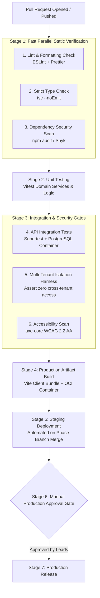

# CI/CD Pipeline Design Specification

This document defines the continuous integration and continuous delivery (CI/CD) workflow design for the **FSD-SDG-4 Quality Education SaaS** platform.

> **Phase 4 CI Status**:  
> `.github/workflows/ci.yml` implements the **Phase 4 Continuous Integration Foundation**: `pnpm install --frozen-lockfile`, `pnpm format:check`, `pnpm lint`, `pnpm typecheck`, `pnpm test`, `pnpm build` (packages then apps), and `pnpm audit --audit-level=high`. Playwright E2E tests are verified locally (`pnpm test:e2e`), and staging/production deployment pipelines (Stages 5–7 below) remain intentionally unimplemented in Phase 4.

---

## 1. Pipeline Architecture Overview

The automated pipeline executes across seven sequential and parallel stages within GitHub Actions:

---

## 2. Stage-by-Stage Specifications

### Stage 1: Fast Static Verification ($\le 90$s target)

- Runs in parallel on lightweight Ubuntu runners.
- Asserts zero ESLint warnings, verifies Prettier formatting, executes strict TypeScript compilation (`tsc --noEmit`), and scans dependencies for known CVEs.

### Stage 2: Unit Testing ($\le 60$s target)

- Executes Vitest unit tests in-memory with fake timers.
- Asserts $\ge 85\%$ line coverage across domain services and business rule validators.

### Stage 3: Integration & Security Testing ($\le 3$ min target)

- Spawns an ephemeral PostgreSQL service container.
- Applies Prisma migrations and seeds minimal synthetic fixtures.
- Runs Supertest API integration tests and the dedicated **Tenant Isolation Test Harness**.
- Runs headless Playwright accessibility tests (`axe-core`).

### Stage 4: Production Build

- Compiles the Vite frontend Single Page Application; asserts bundle budget $< 250\text{ KB}$ gzipped.
- Builds the multi-stage Node.js container image and pushes to container registry.

### Stage 5: Deployment & Release Gates

- Deployment to staging occurs automatically on merge to `main` or active `phase/*` branches.
- Production deployment requires manual approval from Tech Lead Vivek and Product Lead Vishwanath in the GitHub Actions environment protection settings.
