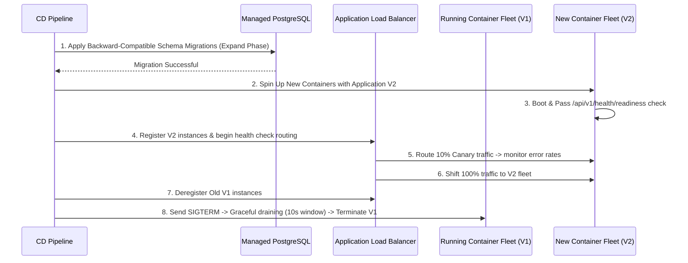

# Deployment and Rollout Strategy

This document defines the deployment methodology, zero-downtime rolling updates, database migration sequencing, and automated rollback protocols for the **FSD-SDG-4 Quality Education SaaS** platform.

---

## 1. Zero-Downtime Deployment Methodology

The platform implements a **Rolling Update / Blue-Green Deployment** strategy to ensure that schools experience zero service interruption during scheduled production updates:

---

## 2. Database Migration Sequencing

Database migrations must never run simultaneously with application code that expects the old schema. We enforce a strict 3-step migration sequence:

1. **Pre-Deployment Migrations (Expand)**:
   - Executed before any new container instances boot.
   - Limited strictly to non-breaking, additive changes: creating new tables, adding nullable columns, creating new indexes.
2. **Container Promotion**:
   - New container instances boot, pass health checks, and begin serving user traffic.
3. **Post-Deployment Migrations (Contract)**:
   - Executed in a subsequent maintenance release after the old code is completely decommissioned.
   - Drops deprecated columns, adds `NOT NULL` constraints to backfilled fields.

---

## 3. Automated Rollback Triggers

The deployment orchestrator automatically aborts promotion and reverts traffic to the previous healthy container fleet if any of the following triggers fire:

- **Readiness Probe Failure**: New container fails to respond `200 OK` on `/api/v1/health/readiness` within 60 seconds of boot.
- **Error Spike**: HTTP $5xx$ error rate exceeds $0.5\%$ of total traffic during the first 5 minutes of canary routing.
- **Latency Anomaly**: P95 response latency on transactional endpoints exceeds $500\text{ ms}$ during canary routing.
- **Manual Abort**: Authorized lead cancels deployment via CD management interface.
