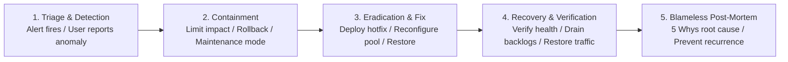

# Incident Response and Management Protocol

This document establishes the incident classification, triage procedures, containment protocols, communication cadence, and blameless post-mortem lifecycle for the **FSD-SDG-4 Quality Education SaaS** platform.

---

## 1. Incident Lifecycle

---

## 2. Incident Roles and Responsibilities

During a declared **P1 Critical** or **P2 Major** incident, team members assume specific command roles:

- **Incident Commander (IC)** (Default: Vivek): Owns operational decision-making, coordinates mitigation tasks, and maintains an objective timeline log.
- **Operations & Database Lead** (Default: Yashwardhan): Investigates database performance, connection pool state, logs, and infrastructure metrics.
- **Communications Lead** (Default: Vishwanath): Communicates incident status to school administrators, publishes status page updates every 30 minutes, and shields engineers from external interruptions.

---

## 3. Standard Containment Actions

1. **Immediate Rollback**: If an incident began immediately following a production deployment, the IC orders an immediate rollback to the previous stable release container before deep investigation.
2. **Maintenance Mode Splash Page**: If database integrity is in jeopardy, the load balancer redirects traffic to a static maintenance page (`503 Service Unavailable`) to prevent further data mutations while repairs occur.
3. **Session Invalidation**: If a credential breach or session vulnerability is suspected, the IC executes global session invalidation (`DELETE FROM sessions;`), forcing all users to re-authenticate.

---

## 4. Blameless Post-Mortem Cadence

Within **48 business hours** of incident resolution:

1. The Incident Commander compiles an Incident Post-Mortem Report using the standardized template in `docs/templates/`.
2. The team conducts a blameless post-mortem review focusing on:
   - _Timeline of Events_: When did it break? When was it detected? When was it fixed?
   - _Root Cause Analysis_: Five Whys methodology to uncover structural/process deficiencies.
   - _Action Items_: Concrete preventative tasks assigned to team members with target completion dates.
