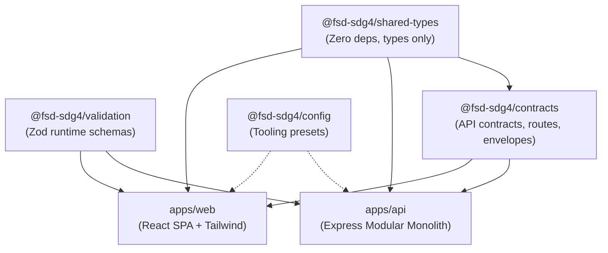

# Workspace Dependency and Import Boundary Policy

**Phase**: `PHASE 4: Repository Scaffolding & Development Environment`  
**Status**: Authoritative Architectural Standard  
**Standard**: Modular Monorepo Boundary Enforcement  
**Last Updated**: 2026-11-05

---

## 1. Package Directory & Architectural Roles

| Workspace Package        | Path                     | Runtime Target         | Allowed Dependencies                                      | Prohibited Dependencies                                       |
| :----------------------- | :----------------------- | :--------------------- | :-------------------------------------------------------- | :------------------------------------------------------------ |
| `@fsd-sdg4/shared-types` | `packages/shared-types/` | Isomorphic (Universal) | None (zero runtime dependencies)                          | Any runtime library, Node.js builtins, Express, React, Prisma |
| `@fsd-sdg4/validation`   | `packages/validation/`   | Isomorphic (Universal) | `zod`                                                     | Express, Pino, React, Prisma, Node.js builtins                |
| `@fsd-sdg4/contracts`    | `packages/contracts/`    | Isomorphic (Universal) | `@fsd-sdg4/shared-types`                                  | Express, Pino, React, Prisma, backend services                |
| `@fsd-sdg4/config`       | `packages/config/`       | Tooling / Build        | Vitest, TypeScript (types only)                           | Domain packages                                               |
| `@fsd-sdg4/api`          | `apps/api/`              | Node.js Server         | Shared packages, Express, Pino, Zod, Prisma (Phase 5+)    | React, React Router, Vite, browser DOM APIs                   |
| `@fsd-sdg4/web`          | `apps/web/`              | Browser SPA            | Shared packages, React, React Router, TanStack Query, Zod | Express, Pino, Prisma, Node.js builtins                       |

---

## 2. Dependency Flow Rules

### 2.1 Core Rules

1. **Strict Upward-Only Dependencies**: Packages may NEVER import from `apps/*`.
2. **No Circular Dependencies**: Circular imports between packages are strictly forbidden.
3. **No Backend Code in Browser Packages**: Packages (`contracts`, `validation`, `shared-types`) must never import Node.js core modules (`fs`, `crypto`, `net`, `child_process`) or backend libraries (`express`, `pino`, `@prisma/client`).
4. **No Secrets in Shared Packages**: Database URLs, JWT secrets, session keys, and environment variables must never be included in shared packages.
5. **Types Only in `shared-types`**: `packages/shared-types` contains exclusively `.d.ts` type declarations and interfaces. No executable JavaScript runtime code is emitted.
